# Diffusion experiments using FDQ

Reference implementations of VAEs, pixel-space and latent diffusion, DiT/ViT
backbones, and flow matching, built on top of
[FDQ](https://github.com/mstadelmann/fonduecaquelon). Two domains: face
generation on CelebA-HQ and CT volume generation/reconstruction on CBCT/CT-RATE.

**Goal**: this repo is not an attempt to produce the best possible images. It's
a playground for exploring and comparing different diffusion-style generative
methods side by side - a starting point for anyone curious about the topic.
Expect visible artifacts, undertrained runs, and outright failures alongside
the good results.

- https://github.com/mstadelmann/fdq_diffusion
- https://github.com/mstadelmann/fonduecaquelon
- https://github.com/CAIIVS/chuchichaestli

## Running an experiment

Locally:
```bash
pip install fdq[full]
git clone https://github.com/mstadelmann/fdq_diffusion.git
cd fdq_diffusion
fdq --config-path configs/celeb_vae --config-name vae_celeb_x128_00_base
```

On a Slurm cluster:

The `slurm_cluster` settings in these configs (partition, account, module
names, storage paths) are tuned for the
[ZHAW SoE Cluster](https://hpc.engineering.zhaw.ch/) (reachable only from
within the ZHAW network). Adjusting the partition/account names and the
system-specific paths will get this running on any Slurm cluster, or of
course locally wherever fdq can be installed.

```bash
# lightweight submit extra, no PyTorch required on the login node
pip install fdq[submit]
git clone https://github.com/mstadelmann/fdq_diffusion.git
cd fdq_diffusion
fdq_submit configs/celeb_vae/vae_celeb_x128_00_base.yaml
```

If package installation is restricted on the login node, use the standalone script:
```bash
wget https://raw.githubusercontent.com/mstadelmann/fonduecaquelon/refs/heads/main/src/fdq/submit.py
python submit.py configs/celeb_vae/vae_celeb_x128_00_base.yaml
```

`submit_celeb.sh` and `submit_ct.sh` list every configured experiment - run
them line by line, not as a script. Executing either file as-is submits every
experiment in it back to back, which is a lot of Slurm jobs and GPU-hours at
once.

## Experiments

| Directory | Contents |
|---|---|
| `configs/celeb_vae` | VAE pretraining, latent space for the models below |
| `configs/celeb_diff_gen_monai` | pixel-space DDPM, MONAI UNet |
| `configs/celeb_diff_gen_cc` | pixel-space DDPM, chuchichaestli UNet |
| `configs/celeb_diff_gen_vit` | pixel-space DDPM, DiT/ViT backbone |
| `configs/celeb_latent_diff` | latent DDPM, UNet backbone |
| `configs/celeb_latent_diff_vit` | latent DDPM, DiT/ViT backbone |
| `configs/celeb_fm_gen` | flow matching, UNet backbone |
| `configs/cbct_vae` | VAE pretraining on CT volumes |
| `configs/cbct_diff_gen`, `cbct_diff_gen_monai` | pixel-space DDPM on CT volumes |
| `configs/cbct_diff_cond_monai` | conditional DDPM, artifact/blur correction |
| `configs/cbct_latent_diff` | latent DDPM on CT volumes |

## Data

**Celeb**: [bitmind/celeb-a-hq](https://huggingface.co/datasets/bitmind/celeb-a-hq)
on Hugging Face - 30,000 images at native 1024x1024, CC-BY-4.0, no login or
token required. Downloaded once and cached locally; see `hf_preparator_celeb.py`.
Train/val/test are fixed, non-overlapping slices of that single split (by row
index, not random), so they're identical across runs.

**CBCT/CT**: currently trained on a locally preprocessed copy of
[CT-RATE](https://huggingface.co/datasets/ibrahimhamamci/CT-RATE) staged on
the cluster (see `nifity_preparator.py`, `data.ctrate.args.root_path`). Not
yet loaded directly from Hugging Face - migrating this to the same
download-once approach used for Celeb is planned.


## Results

### CELEB VAE

#### vae_celeb_x128_00_dist2.yaml
- Keywords: VAE, KL-regularized autoencoder, 128px, latents for the models below
- GPU: 2x A100
- Train: 365 EP, 5h4m, 54s/EP


- Quality: sharp, faithful reconstructions, no visible artifacts

#### vae_celeb_x256_00.yaml
- Keywords: VAE, 256px, higher-resolution latents
- GPU: H100
- Train: 223 EP, 17h51m, 7m32s/EP


- Quality: sharp, faithful reconstructions, on par with the 128px VAE

#### vae_celeb_x512_00.yaml
- Keywords: VAE, 512px, highest-resolution latents
- GPU: H200
- Train: 259 EP, 42h19m combined, 9m28s/EP (stopped early: ValLoss_stagnated)


- Quality: sharp, faithful reconstructions, no degradation despite early stop

---

### CELEB DIFF GEN

#### MONAI UNet

##### dg_m_cele_x128_00_base_dist2.yaml
- Keywords: pixel-space DDPM, MONAI UNet, baseline architecture, 128px
- GPU: 2x A100
- Train: 129 EP, 8h33m, 3m59s/EP (stopped early: ValLoss_stagnated)


- Quality: About 2-3/10 faces show a mild olive/yellow color-cast, rest look real

##### dg_m_cele_x128_01.yaml (resblock_updown: false)
- Keywords: architecture ablation, UNet residual blocks disabled
- GPU: 2x A100
- Train: 183 EP, 10h36m, 3m22s/EP


- Quality: good - all 10 faces read as real, no color-cast or anatomical distortion

##### dg_m_cele_x128_02.yaml (3 att levels)
- Keywords: architecture ablation, attention at 3 resolution levels
- GPU: 2x A100
- Train: 153 EP, 19h58m, 7m42s/EP


- Quality: good - all 10 faces read as real, only faint background bleed on 1-2

##### dg_m_cele_x128_03.yaml (4 layers only)
- Keywords: capacity ablation, UNet depth reduced to 4 levels
- GPU: 2x A100
- Train: 85 EP, 9h51m, 6m52s/EP


- Quality: good - coherent, real-looking faces despite heavy punk/goth styling; no anatomical distortion

##### dg_m_cele_x128_08_zero_snr.yaml (zero-SNR fix, v-pred)
- Keywords: zero terminal-SNR noise schedule, v-prediction parameterization
- GPU: 2x A100
- Train: 96 EP, 6h16m, 3m46s/EP


- Quality: good - real, coherent faces despite heavy makeup styling

##### dg_m_cele_x256_00.yaml (256px, 2 GPUs)
- Keywords: same baseline architecture, scaled to 256px
- GPU: 2x H200
- Train: 149 EP, 40h35m combined, 13m35s/EP (stopped early: TrainLoss_stagnated)


- Quality: bad - every one of the 10 faces has an unnatural color-cast (teal/blue/red/maroon skin), none look like real skin tones

##### dg_m_cele_x256_01_zero_snr.yaml (256px, zero-SNR fix)
- Keywords: zero-SNR/v-pred fix applied at 256px
- GPU: 2x H200
- Train: 109 EP, 11h2m, 6m0s/EP


- Quality: bad - only about 4/10 faces look genuinely real; the rest are severely textured, melted, or scribbled beyond recognition

#### Chuchichaestli UNet

##### dg_c_celeb_x128_00_base.yaml (baseline)
- Keywords: pixel-space DDPM, chuchichaestli UNet, baseline architecture, 128px
- GPU: 2x A100
- Train: 266 EP, 4h6m, 56s/EP (stopped early: ValLoss_stagnated)


- Quality: good - all 10 faces read as real and coherent, no color-cast or texture-bleed artifacts

##### dg_c_celeb_x128_01.yaml (LR param, 4 parallel runs)
- Keywords: learning-rate sweep, 4 parallel runs at different LR values
- GPU: 2x A100

| Train | Image | Quality |
|---|---|---|
| 178 EP, 2h55m, 1m0s/EP |  | 1/10 badly melted/deformed (not a real face), rest look real |
| 116 EP, 1h52m, 54s/EP |  | 1/10 an indistinct blurry non-face, rest look real |
| 166 EP, 2h40m, 54s/EP |  | bad - every face rendered as a thick oil-painting texture, none look like real photos |
| 146 EP, 2h22m, 59s/EP |  | bad - most faces (6/10) are foggy, ghostly, or indistinct, not recognizable as real |

> **Parameter study**: `lr@p: [0.00001:0.005:4]` is a *linear* sweep (fdq's `@p` range
> syntax interpolates linearly, not log-spaced), giving LR ≈ 1e-5, 1.67e-3, 3.33e-3,
> 5e-3 - vs. the baseline's 5e-5.
> **Outcome**: training holds up to ~1.67e-3 (33x the baseline LR), then breaks down
> somewhere between 1.67e-3 and 3.33e-3 - p003 collapses into a uniform oil-painting
> texture and p004 (max LR) never resolves fine detail, staying foggy/washed out.
> There's no data point between 5e-5 and 1.67e-3, so whether anything above baseline
> is an actual improvement (vs. simply not-yet-broken) is unknown.
> **Before rerunning**: use a log-spaced sweep bracketing the instability cliff (e.g.
> `[0.00005:0.002:5]`) instead of a linear one, and run the surviving LRs with 2-3
> seeds each - a single 10-sample grid can't separate "this LR is better" from
> ordinary run-to-run variance (see the baseline note above).

##### dg_c_celeb_x128_02.yaml (lin/cos/sig param, 3 parallel runs)
- Keywords: noise-schedule sweep, linear vs cosine vs sigmoid beta schedule, 3 parallel runs
- GPU: 2x A100

| Train | Image | Quality |
|---|---|---|
| 200 EP, 3h11m, 56s/EP |  | good - all 10 faces look real and coherent |
| 172 EP, 2h44m, 53s/EP |  | 2/10 unnatural (bright orange scalp patch, deep magenta face), rest look real |
| 216 EP, 3h31m, 54s/EP |  | 2/10 clearly unrealistic (indistinct dark face, magenta cast), rest look real |

> **Parameter study**: categorical sweep over `diffusion_scheduler`
> (linear/cosine/sigmoid), same `beta_start`/`beta_end` for all three - otherwise
> identical to the baseline config (same LR, same architecture).
> **Outcome**: linear scored best (10/10 real), cosine and sigmoid each had 2/10
> unnatural samples. But the linear run here (p001) is the *same config* as
> `dg_c_celeb_x128_00_base.yaml` above, just trained ~35 epochs longer, and it scored
> noticeably better than that baseline run did (10/10 vs. mixed with background
> bleed). That gap - from epoch count and seed alone - is at least as large as the
> gap between schedules, so this ranking is likely confounded rather than a real
> "linear beats cosine/sigmoid" result.
> **Before rerunning**: pin all three to the same epoch count (or the same
> early-stop criterion) and run 2-3 seeds per schedule before trusting any ranking.

##### dg_c_celeb_x256_00_base.yaml (256px)
- Keywords: same baseline architecture, scaled to 256px
- GPU: 2x H200
- Train: 263 EP, 4h58m, 1m8s/EP (stopped early: ValLoss_stagnated)


- Quality: bad - only about 2/10 faces look real, rest show strong blue/purple/green color-cast or heavy distortion

#### VIT (DiT)

##### dg_vit_celeb_x128_00_base_dist2.yaml (2 GPUs)
- Keywords: pixel-space DDPM, DiT/ViT backbone instead of UNet, 128px
- GPU: 2x A100
- Train: 350 EP, 56h33m combined, 9m32s/EP


- Quality: mixed - 2/10 have a dark disfiguring blob over the mouth/chin, rest look real

##### dg_vit_celeb_x256_00_base.yaml (256px, 2 GPUs)
- Keywords: same ViT/DiT backbone, scaled to 256px
- GPU: 2x H200
- Train: 302 EP, 35h16m combined, 10m50s/EP (stopped early: TrainLoss_stagnated)


- Quality: bad - half the faces (5/10) are heavily smeared or textured, not recognizable as real skin

> **Note**: `patch_size` was doubled to 8 here (from 4 at 128px) to keep the token
> count/attention compute constant at the larger resolution. This is pixel-space
> diffusion, so the coarser patch likely trades
> away exactly the per-patch fidelity that mattered - `patch_size` would probably need
> to come back down to 4 to fix the smearing, at the cost of ~4x more tokens and
> correspondingly more compute/VRAM.

---

### CELEB DIFF COND

#### MONAI UNet

##### dc_m_celeb_x128_deblur.yaml
- Keywords: conditional DDPM, deblurring, blurred image as condition, MONAI UNet
- GPU: A100
- Train: 151 EP, 20h1m, 7m57s/EP (stopped early: ValLoss_stagnated)


- Quality: excellent, deblurred result nearly indistinguishable from ground truth

##### dc_m_celeb_x128_hard.yaml (harder condition: blur + cutout + salt-pepper + Gaussian noise)
- Keywords: conditional DDPM, MONAI UNet, condition stacks blur with random cutout patches, salt-and-pepper noise, and Gaussian noise (resampled every epoch), inpainting/denoising rather than plain deblurring
- GPU: A100
- Status: still training - `job_time` (23.3h) is shorter than this run needs, so it checkpoints and auto-resubmits itself rather than finishing in one job. 2 segments completed so far (~46h combined), last checkpoint at epoch 204/350, a 3rd segment is queued (pending on cluster priority as of this check). No test results yet.

##### dc_m_celeb_x128_halfface.yaml (condition is half the face blacked out)
- Keywords: conditional DDPM, MONAI UNet, outpainting, condition is the GT with a random half (left/right, resampled every epoch via RandomEdgeMask) blacked out, model reconstructs the missing half
- GPU: A100
- Status: still training - same checkpoint/auto-resubmit pattern as the `hard` run above. 1st segment reached epoch 104/350 (~23h) before hitting the job time limit; the 2nd segment is running now. No test results yet.

#### Chuchichaestli UNet

##### dc_cc_celeb_x128_deblur.yaml
- Keywords: same conditional deblurring task, chuchichaestli UNet backbone
- GPU: 2x A100
- Train: 219 EP, 3h29m, 57s/EP (stopped early: ValLoss_stagnated)


- Quality: excellent, on par with the MONAI version

##### dc_cc_celeb_x128_hard.yaml (harder condition: blur + cutout + salt-pepper + Gaussian noise)
- Keywords: conditional DDPM, chuchichaestli UNet, condition stacks blur with random cutout patches, salt-and-pepper noise, and Gaussian noise (resampled every epoch), inpainting/denoising rather than plain deblurring
- GPU: 2x A100
- Train: 213 EP, 6h20m, 1m47s/EP (stopped early: ValLoss_stagnated)


- Quality: good - all 10 results plausibly reconstruct the GT despite the heavy corruption, no clear residual artifacts this time (an improvement on the previous run's 1/10 dark-eye artifact)

##### dc_cc_celeb_x128_halfface.yaml (condition is half the face blacked out)
- Keywords: conditional DDPM, chuchichaestli UNet, outpainting, condition is the GT with a random half (left/right, resampled every epoch via RandomEdgeMask) blacked out, model reconstructs the missing half
- GPU: 2x A100
- Train: 170 EP, 4h28m, 1m35s/EP (stopped early: ValLoss_stagnated)


- Quality: good - most outpainted halves (9/10) are plausible and coherent with the visible half, 1/10 (the striped-shirt sample) shows the shirt's pattern bleeding into the outpainted face region

---

### CELEB Latent Diffusion

#### lat_diff_celeb_x128_00_base.yaml (UNet backbone)
- Keywords: diffusion over frozen VAE latents, UNet backbone, 128px
- GPU: H200
- Train: 224 EP, 15h2m, 4m2s/EP (stopped early: ValLoss_stagnated)


- Quality: good - 19/20 faces look real, 1 with rough discolored skin

#### lat_diff_celeb_x256_00.yaml (256px)
- Keywords: same latent UNet approach, scaled to 256px
- GPU: H200
- Train: 174 EP, 13h5m, 4m31s/EP (stopped early: TrainLoss_stagnated)


- Quality: good - 19/20 faces look real, 1 clearly non-human (rough beast-like texture)

#### VIT (DiT) backbone, same pretrained VAEs

##### lat_diff_vit_celeb_x128_00_base.yaml
- Keywords: latent diffusion, DiT/ViT backbone instead of UNet, 128px
- GPU: H200
- Train: 400 EP, 13h27m, 2m2s/EP


- Quality: good - all 20 faces look real, no standout failures

##### lat_diff_vit_celeb_x256_00.yaml (256px)
- Keywords: same latent ViT/DiT approach, scaled to 256px
- GPU: H200
- Train: 400 EP, 52h29m combined, 7m47s/EP


- Quality: good - 19/20 faces look real, 1 clearly non-human (same recurring beast-like texture as the UNet 256px run)

### CELEB Flow Matching Generative

#### fm_meta_cele_x128_v0.yaml (baseline)
- Keywords: flow matching, MetaUNet, straight-line velocity-field regression, no fixed noise schedule, 128px
- GPU: 2x H200
- Train: 650 EP, 84h20m combined, 7m47s/EP


- Quality: excellent, the sharpest and most photorealistic results in this repo

#### fm_meta_cele_x128_v1.yaml (smaller batch)
- Keywords: same flow matching setup, smaller training batch size
- GPU: 2x H200
- Train: 650 EP, 80h26m combined, ~7m25s/EP (1 restart from scratch after a DDP/NCCL crash)


- Quality: excellent, on par with the baseline

#### fm_meta_cele_x128_v2.yaml (EMA, attn tweaks)
- Keywords: adds EMA weight averaging and attention-head tweaks to the baseline
- GPU: 2x H200
- Train: 426/650 EP, 45h41m combined, 6m26s/EP

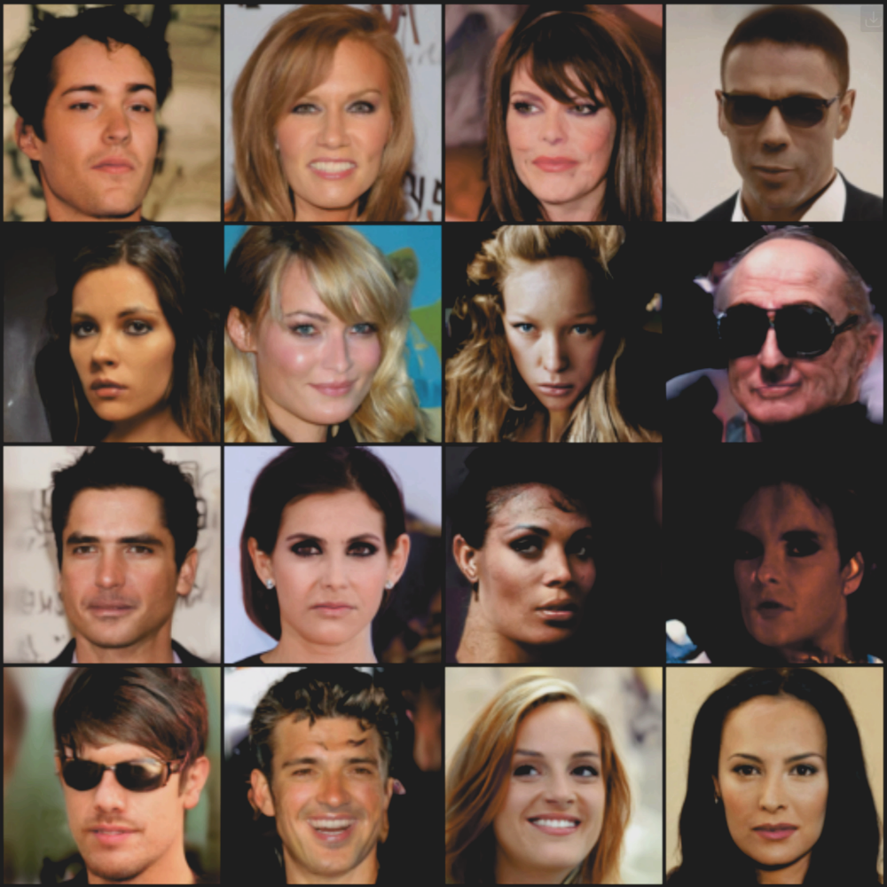
- Quality: all 16 faces look sharp, no color-cast or major anatomical distortion

#### fm_meta_cele_x256_v0.yaml (256px)
- Keywords: same baseline flow matching setup, scaled to 256px
- GPU: 2x H200
- Train: 71/650 EP, 122h41m combined, 1h43m/EP

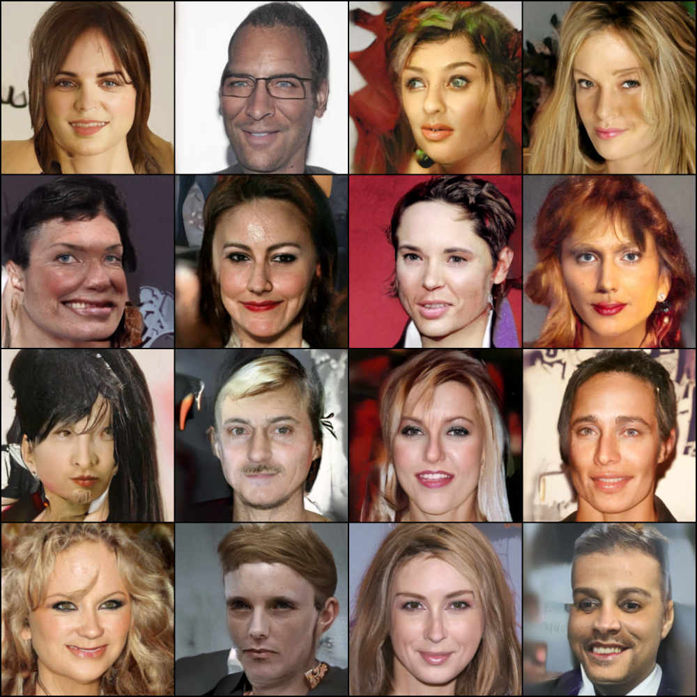
- Quality: surprisingly good for only 71/650 EP - most of the 16 faces are coherent and mostly photorealistic, a few show soft/noisy texture typical of an undertrained model

---

### CBCT VAE

All CBCT autoencoders share the same test routine (`ae_test_eval.py`). Each test uses the same 20 CT-RATE validation scans, in the same order, so sample 0 is the same patient in every experiment. Each entry shows:
- the detailed result of test sample 0: GT / Recon / Diff / GT HU / Recon HU, each with an axial slice, a histogram of the full volume, and two orthogonal slices
- the `results_overview`: an axial slice of the reconstruction of every test sample

> Note: in these test runs (slurm 146183-146191) the rows labelled "sagittal" and "coronal" are swapped. The "sagittal" row actually shows a coronal slice and vice versa. Fixed in the configs for future runs.

| Experiment | Res | PSNR | PSNR HU |
| --- | --- | --- | --- |
| vae_cbct_x64_v0_dist2 (trained) | 64 | 27.6 | 25.7 |
| vae_cbct_x128_v0 (trained) | 128 | 27.9 | 25.9 |
| vae_cbct_x256_v0 (trained) | 256 | 27.7 | 25.8 |
| vae_cbct_maisi_x128 (pretrained) | 128 | 26.8 | 24.8 |
| vae_cbct_maisi_x256 (pretrained) | 256 | 28.6 | 26.7 |
| vae_cbct_maisi_x256_v1 (pretrained) | 256 | 25.7 | 25.7 |
| vae_cbct_maisi_x256_v2 (pretrained) | 256 | 35.6* | **29.6** |
| vae_cbct_wan2_x128 (pretrained) | 128 | 28.2 | 26.3 |

Mean over the 20 test samples. \*PSNR (norm) assumes a [-1,1] data range, so for v2's [0,1] normalization it is inflated by ~6 dB. Compare runs on PSNR HU.

#### vae_cbct_x64_v0_dist2.yaml
- Keywords: VAE, KL-regularized autoencoder, CT-RATE chest CT volumes, 64px
- GPU: 2x H200
- Train: 89 EP, 3h50m, 2m35s/EP (stopped early: ValLoss_stagnated)
- Test: 20 samples, PSNR 27.6 (25.7 HU) - [wandb](https://wandb.ai/zhaw_stmd/cbct_vae_x64/runs/p7qu3kov) (146183)

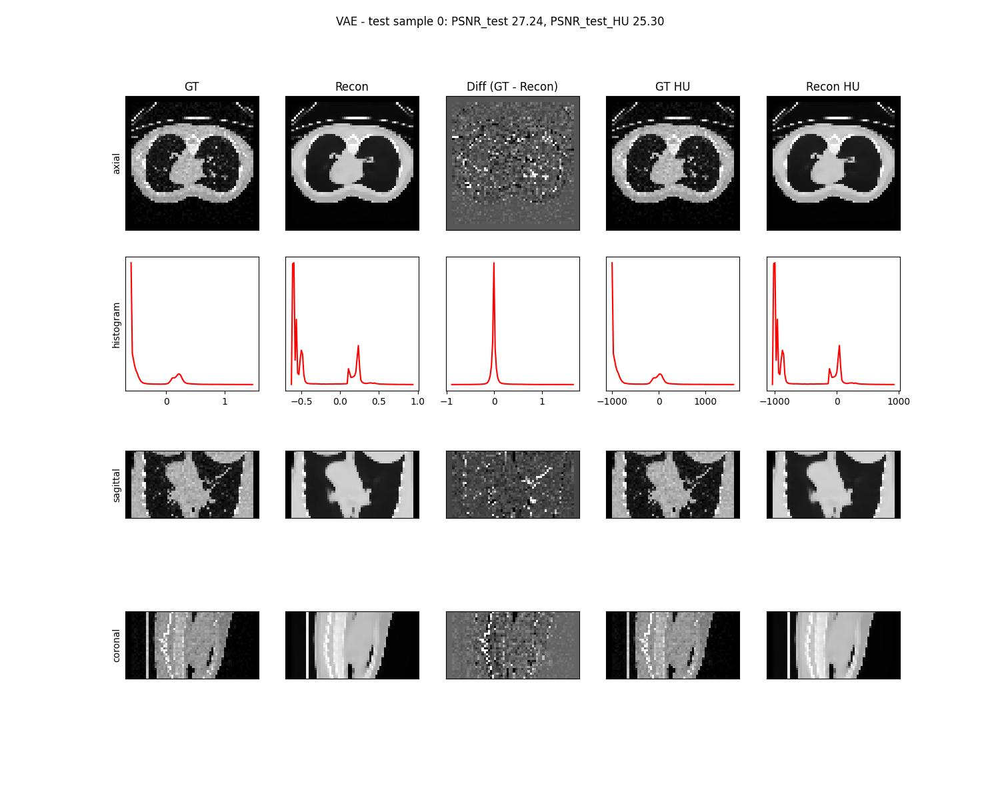
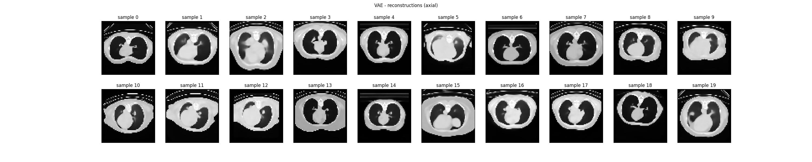
- Quality: coarse. Body outline, lungs and heart are correct, but the reconstruction is a smooth "cartoon": lung vessels/bronchi and image noise are gone, so the diff map is dominated by fine lung structure

#### vae_cbct_x128_v0.yaml
- Keywords: VAE, 128px, higher-resolution CT latents
- GPU: 2x H200
- Train: 113 EP, 18h2m, 9m34s/EP (stopped early: ValLoss_stagnated)
- Test: 20 samples, PSNR 27.9 (25.9 HU) - [wandb](https://wandb.ai/zhaw_stmd/cbct_vae_x128/runs/i0upzmvm) (146184)

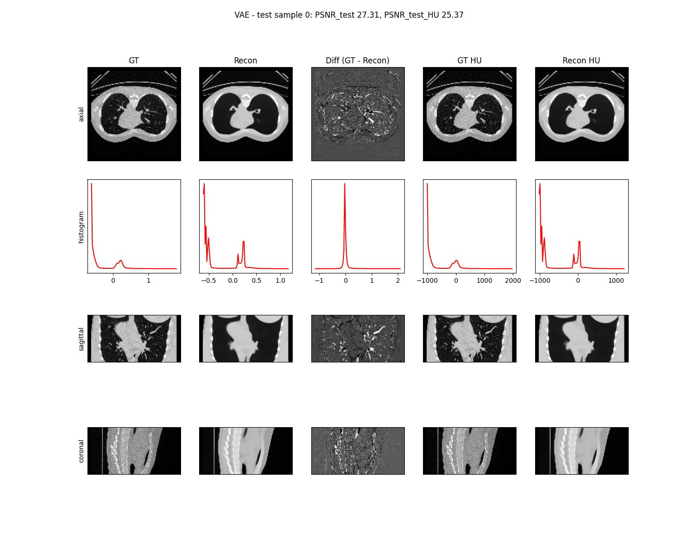
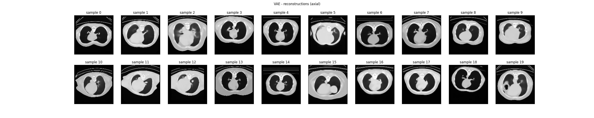
- Quality: coarse, same pattern as 64px. Sharper outlines, ribs and spine, but the lung vasculature is still smoothed away (clearly visible as structure in the diff map). Large pathologies survive (e.g. the cavity in sample 19)

#### vae_cbct_x256_v0.yaml
- Keywords: VAE, 256px
- GPU: H200
- Train: 41/50 EP, ~142h combined over 8 resubmitted jobs, ~3.5h/EP (training not finished)
- Test: 20 samples, PSNR 27.7 (25.8 HU) - [wandb](https://wandb.ai/zhaw_stmd/cbct_vae_x256/runs/v38gegmx) (146185)

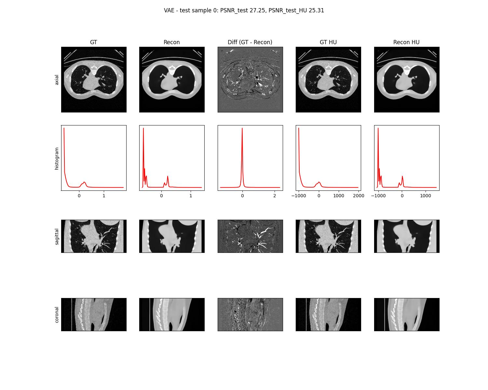
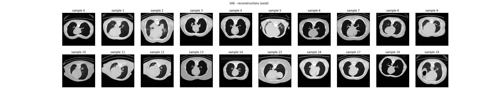
- Quality: crisp edges, but no lung vessels or bronchi and no noise texture. No PSNR gain over 128px; the trained VAE does not use the extra resolution

#### MAISI (pretrained, zero-shot test - no training)

##### vae_cbct_maisi_x128.yaml
- Keywords: pretrained NVIDIA MAISI VAE, no training, 128px
- GPU: H200
- Test: 20 samples, 15s, PSNR 26.8 (24.8 HU) - [wandb](https://wandb.ai/zhaw_stmd/cbct_vae_maisi_x128/runs/ueah7q62) (146187)

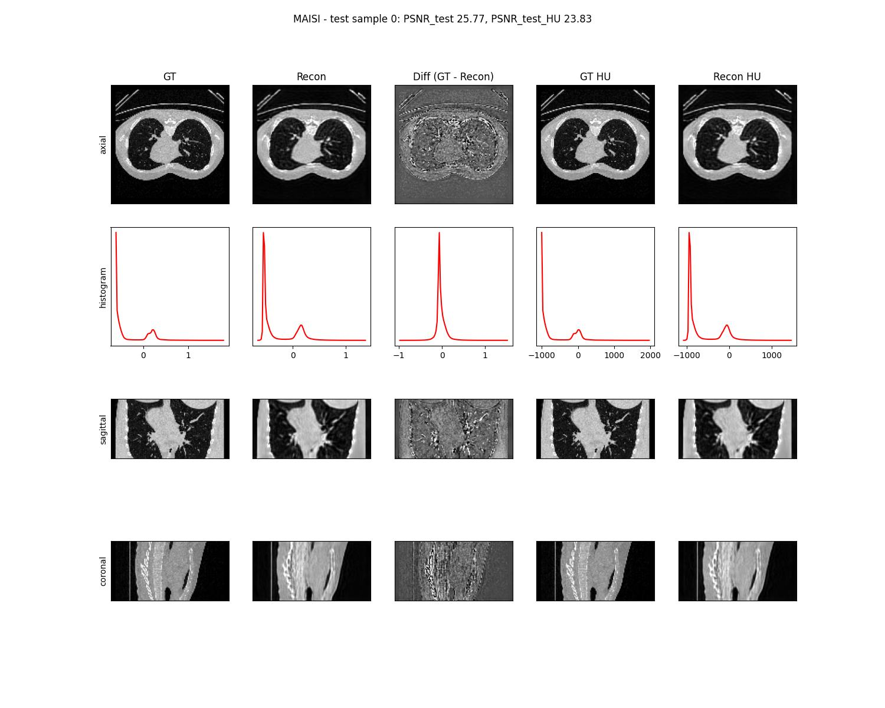
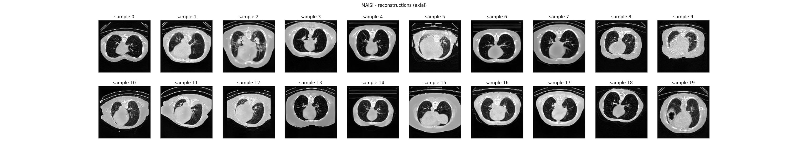
- Quality: keeps lung vessels and texture, unlike the trained VAEs, but looks grainy. There is a small intensity offset (air peak shifted, diff histogram not centered at 0), so its PSNR is below the trained VAEs despite much more detail

##### vae_cbct_maisi_x256.yaml
- Keywords: same pretrained MAISI VAE, 256px
- GPU: H200
- Test: 20 samples, 33s, PSNR 28.6 (26.7 HU) - [wandb](https://wandb.ai/zhaw_stmd/cbct_vae_maisi_x256/runs/50yf9t53) (146188)

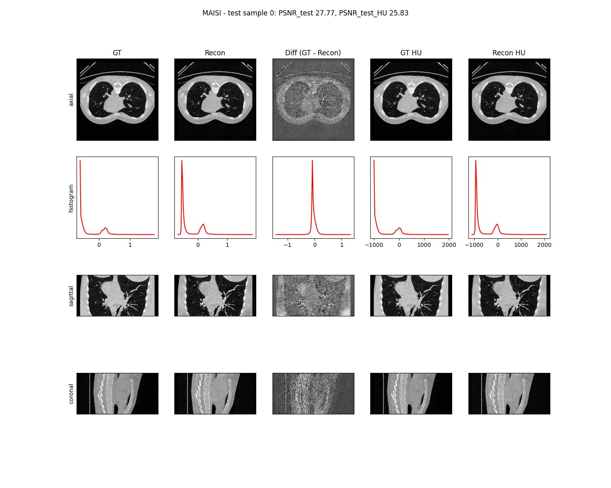
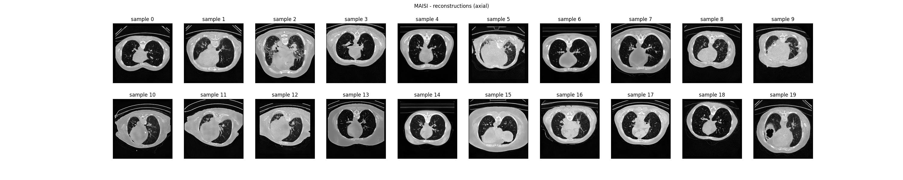
- Quality: sharp, faithful reconstruction, vessels and bronchi well preserved. The diff map is mostly noise plus a slight intensity bias

##### vae_cbct_maisi_x256_v1.yaml (HU window narrowed to [-1000,1000])
- Keywords: same as x256, HU_to_norm window narrowed from [-1500,1000] to [-1000,1000], still normalized to [-1,1]
- GPU: H200
- Test: 20 samples, 32s, PSNR 25.7 (25.7 HU) - [wandb](https://wandb.ai/zhaw_stmd/cbct_vae_maisi_x256/runs/lv75d53i) (146189)

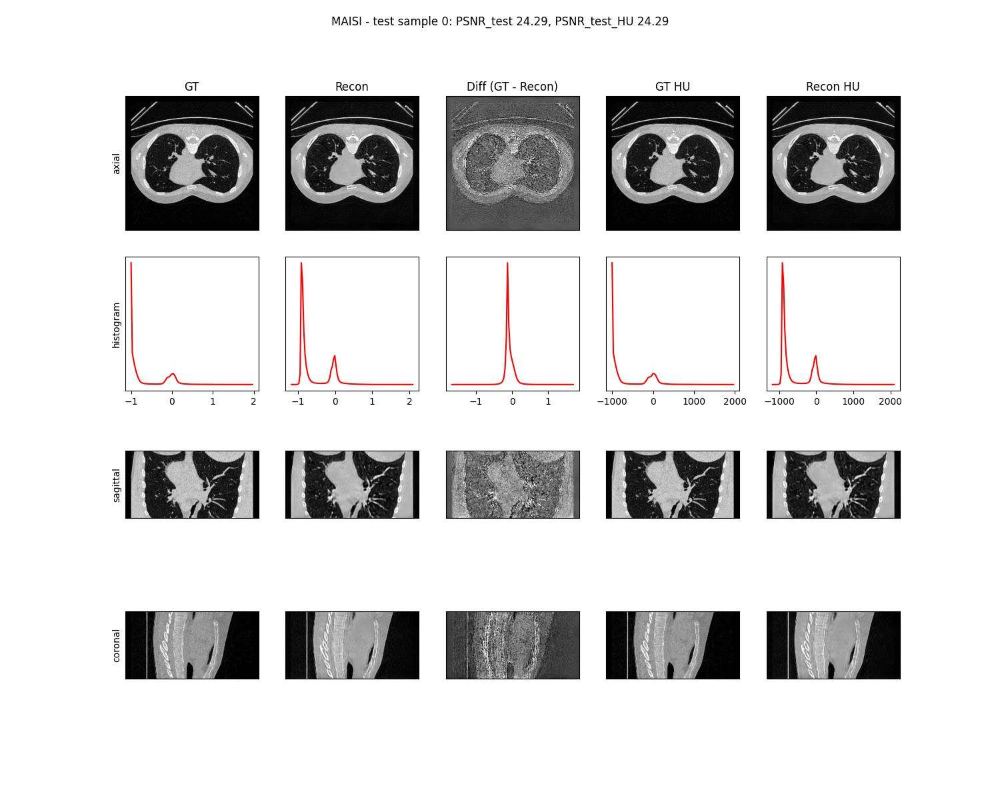

- Quality: visually as sharp as x256, but with a clear intensity bias. The diff map shows the body as a brighter region and the diff histogram peaks off 0. Worst of the MAISI runs; narrowing the window this way doesn't help

##### vae_cbct_maisi_x256_v2.yaml (HU window [-1000,1000], normalized to [0,1])
- Keywords: same [-1000,1000] HU window as v1, but normalized to [0,1] instead of [-1,1]
- GPU: H200
- Test: 20 samples, 46s, PSNR 35.6 (29.6 HU) - [wandb](https://wandb.ai/zhaw_stmd/cbct_vae_maisi_x256/runs/63rgxz9e) (146190)

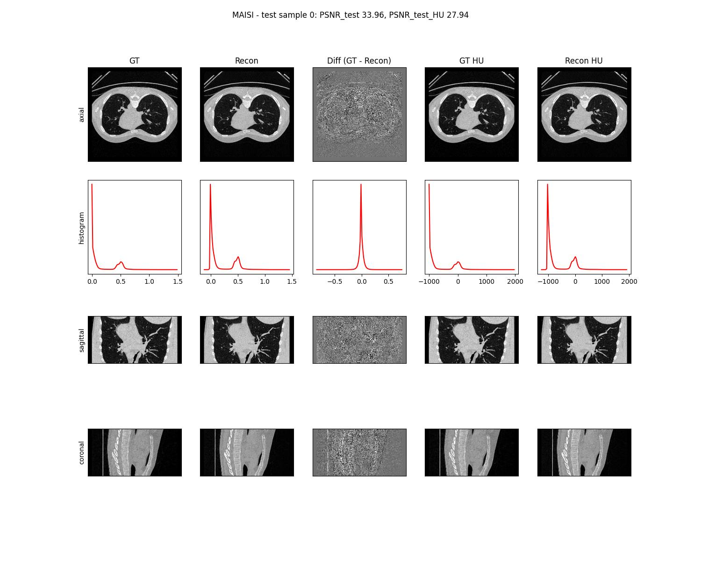
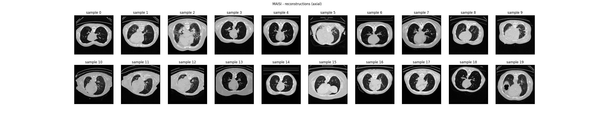
- Quality: best overall. The diff map is structureless noise centered at 0, with no bias or anatomical edges. Highest PSNR HU by ~3 dB; the [0,1] input normalization (which matches MAISI's training range) is what matters

#### Wan2.2 (pretrained video VAE, zero-shot test - no training)

##### vae_cbct_wan2_x128.yaml
- Keywords: pretrained Wan2.2 video VAE (TI2V-5B), depth axis used as the time axis, grayscale repeated to 3 channels, 128px
- GPU: H200
- Test: 20 samples, 13s, PSNR 28.2 (26.3 HU) - [wandb](https://wandb.ai/zhaw_stmd/cbct_vae_wan2_x128/runs/svt7f8f1) (146191)

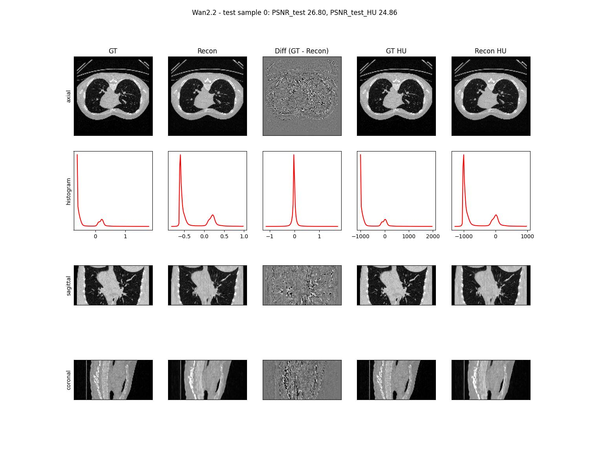
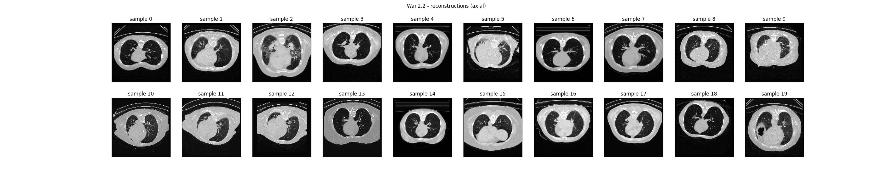
- Quality: sharp, vessels and lung texture preserved, slightly speckled. Clearly better than MAISI at the same 128px resolution (+1.4 dB PSNR HU) and better than all the trained VAEs
