# Diffusion experiments using FDQ

Reference implementations of VAEs, pixel-space and latent diffusion, DiT/ViT
backbones, and flow matching, built on top of
[FDQ](https://github.com/mstadelmann/fonduecaquelon). Two domains: face
generation on CelebA-HQ and CT volume generation/reconstruction on CT-RATE
chest CTs. The experiment and config names use "cbct" for historical reasons:
all CT experiments in this repo use the (fan-beam) CT volumes of CT-RATE.

**Goal**: this repo is not an attempt to produce the best possible images. It's
a playground for exploring and comparing different diffusion-style generative
methods side by side - a starting point for anyone curious about the topic.
Expect visible artifacts, undertrained runs, and outright failures alongside
the good results.

- https://github.com/mstadelmann/fdq_diffusion
- https://github.com/mstadelmann/fonduecaquelon
- https://github.com/CAIIVS/chuchichaestli

## Running an experiment

### Setup

The configs reference the scripts in this repository by absolute path
(`~/dev/fdq_diffusion/...`, e.g. `train.path`, `data.*.processor`). Either
clone the repository to `~/dev/fdq_diffusion`, or adjust these paths.

Every config includes a `wandb_keys.yaml` from its own config directory, which
holds your personal [Weights & Biases](https://wandb.ai) API key and is not
part of the repository. Create it from the template before the first run, and
change `store.wandb_entity` to your own W&B entity, or disable W&B logging:
```bash
cp wandb_keys.example.yaml configs/celeb_vae/wandb_keys.yaml   # then add your key
```

Some configs contain further system-specific paths that need to be adjusted:
`store.results_path`, `data.*.caching.cache_dir`, `data.ctrate.args.root_path`
(location of the preprocessed CT-RATE data, see [Data and
licenses](#data-and-licenses)), `globals.uv_cache_dir`, and the
`trained_model_path` of the frozen VAEs used by the latent diffusion configs
(set it to the checkpoint of your own VAE run).

### Locally
```bash
git clone https://github.com/mstadelmann/fdq_diffusion.git ~/dev/fdq_diffusion
cd ~/dev/fdq_diffusion
pip install fdq[full] -r requirements.txt
cp wandb_keys.example.yaml configs/celeb_vae/wandb_keys.yaml
fdq --config-path configs/celeb_vae --config-name vae_celeb_x128_00_base store.use_wandb=false
```

### On a Slurm cluster

The `slurm_cluster` settings in these configs (partition, account, module
names, storage paths) are tuned for the
[ZHAW SoE Cluster](https://hpc.engineering.zhaw.ch/) (reachable only from
within the ZHAW network). Adjusting the partition/account names and the
system-specific paths will get this running on any Slurm cluster, or of
course locally wherever fdq can be installed.

```bash
# lightweight submit extra, no PyTorch required on the login node
pip install fdq[submit]
git clone https://github.com/mstadelmann/fdq_diffusion.git ~/dev/fdq_diffusion
cd ~/dev/fdq_diffusion
fdq_submit configs/celeb_vae/vae_celeb_x128_00_base.yaml
```

If package installation is restricted on the login node, use the standalone script:
```bash
wget https://raw.githubusercontent.com/mstadelmann/fonduecaquelon/refs/heads/main/src/fdq/submit.py
python submit.py configs/celeb_vae/vae_celeb_x128_00_base.yaml
```

`submit_celeb.sh` and `submit_ct.sh` list every configured experiment - run
them line by line, not as a script. Executing either file as-is submits every
experiment in it back to back, which is a lot of Slurm jobs and GPU-hours at
once.

## Experiments

Numbers in brackets refer to the [References](#references).

| Directory | Contents |
|---|---|
| `configs/celeb_vae` | VAE [2] pretraining, latent space for the models below |
| `configs/celeb_diff_gen_monai` | pixel-space DDPM [1], MONAI UNet [4, 26], zero terminal SNR / v-prediction [10, 11] |
| `configs/celeb_diff_gen_cc` | pixel-space DDPM [1], chuchichaestli UNet [25], noise schedule sweep [8, 9] |
| `configs/celeb_diff_gen_vit` | pixel-space DDPM, DiT/ViT backbone [6, 7, 28] |
| `configs/celeb_diff_cond_monai`, `celeb_diff_cond_cc` | conditional DDPM (deblurring, inpainting, outpainting), MONAI / chuchichaestli UNet |
| `configs/celeb_latent_diff` | latent DDPM [3], UNet backbone |
| `configs/celeb_latent_diff_vit` | latent DDPM [3], DiT/ViT backbone [7] |
| `configs/celeb_fm_gen` | flow matching [12, 13], guided-diffusion UNet [5] |
| `configs/cbct_vae` | VAE [2] pretraining on CT volumes, zero-shot tests of pretrained MAISI [15] and Wan2.2 [16] VAEs |
| `configs/cbct_diff_gen_monai`, `cbct_diff_gen_cc` | pixel-space DDPM on CT volumes, MONAI / chuchichaestli UNet |
| `configs/cbct_diff_cond_monai`, `cbct_diff_cond_cc` | conditional DDPM, artifact/blur correction, MONAI / chuchichaestli UNet |
| `configs/cbct_latent_diff` | latent DDPM [3] on CT volumes, frozen pretrained MAISI [15] or trained CT VAE |

## Data and licenses

No data and no pretrained weights are included in this repository. They are
downloaded from their original sources and are subject to their own terms.

**CelebA-HQ**: loaded from the Hugging Face mirror
[bitmind/celeb-a-hq](https://huggingface.co/datasets/bitmind/celeb-a-hq)
(30,000 images at native 1024x1024, no login or token required), downloaded
once and cached locally; see `hf_preparator_celeb.py`. Train/val/test are
fixed, non-overlapping slices of that single split (by row index, not random),
so they're identical across runs. CelebA-HQ [[18]](#references) is derived from
CelebA [[17]](#references). Although the mirror is tagged CC-BY-4.0, the
images remain subject to the
[CelebA terms](https://mmlab.ie.cuhk.edu.hk/projects/CelebA.html):
non-commercial research use only, the images are not owned by the dataset
creators, and they must not be redistributed. CelebA-HQ itself is released
under [CC BY-NC 4.0](https://github.com/tkarras/progressive_growing_of_gans).

**CT-RATE**: chest CT volumes from
[CT-RATE](https://huggingface.co/datasets/ibrahimhamamci/CT-RATE)
[[19-23]](#references) (gated, CC BY-NC-SA 4.0, research use only, no
redistribution of the data or any portion thereof). `prepare_CT_RATE.py`
downloads and preprocesses the volumes (HU clipping, reorientation, isotropic
resampling, crop/pad to a fixed size); `nifity_preparator.py` loads the
preprocessed files (`data.ctrate.args.root_path`). Downloading requires
accepting the dataset terms and a Hugging Face token (`HUGGINGFACE_TOKEN`).

**Figures**: the figures in `assets/` are low-resolution result plots (at most
~200 px per panel). Besides generated samples, the VAE and conditional
experiments show the corresponding test inputs (ground truth / condition) for
comparison. These are shown for illustration only; no dataset files are part of
this repository. Face images derived from CelebA-HQ remain subject to the
CelebA terms. Figures derived from CT-RATE are shared under
[CC BY-NC-SA 4.0](https://creativecommons.org/licenses/by-nc-sa/4.0/), as
required by the CT-RATE license.

**Pretrained models**: the MAISI VAE [[15]](#references) is downloaded from
NVIDIA (see `maisi.py`) and is subject to the
[NVIDIA license of the MONAI model zoo bundle](https://github.com/Project-MONAI/model-zoo/blob/dev/models/maisi_ct_generative/LICENSE)
(non-commercial, research and evaluation only). The Wan2.2 VAE
[[16]](#references) (`Wan-AI/Wan2.2-TI2V-5B-Diffusers`, Apache-2.0) is
downloaded from Hugging Face (see `wan2.py`).


## Results

### CELEB VAE

#### vae_celeb_x128_00_dist2.yaml
- Keywords: VAE, KL-regularized autoencoder, 128px, latents for the models below
- GPU: 2x A100
- Train: 365 EP, 5h4m, 54s/EP


- Quality: good. Sharp reconstructions, no visible artifacts

#### vae_celeb_x256_00.yaml
- Keywords: VAE, 256px, higher-resolution latents
- GPU: H100
- Train: 223 EP, 17h51m, 7m32s/EP


- Quality: good, same as the 128px VAE

#### vae_celeb_x512_00.yaml
- Keywords: VAE, 512px, highest-resolution latents
- GPU: H200
- Train: 259 EP, 42h19m, 9m28s/EP (stopped early: ValLoss_stagnated)


- Quality: good, same as the smaller VAEs

---

### CELEB DIFF GEN

#### MONAI UNet

##### dg_m_cele_x128_00_base_dist2.yaml
- Keywords: pixel-space DDPM, MONAI UNet, baseline architecture, 128px
- GPU: 2x A100
- Train: 129 EP, 8h33m, 3m59s/EP (stopped early: ValLoss_stagnated)


- Quality: ok. Most faces look real, 2-3/10 have a slight olive/yellow color cast

##### dg_m_cele_x128_01.yaml (resblock_updown: false)
- Keywords: architecture ablation, UNet residual blocks disabled
- GPU: 2x A100
- Train: 183 EP, 10h36m, 3m22s/EP


- Quality: good. All 10 faces look real, no color cast

##### dg_m_cele_x128_02.yaml (3 att levels)
- Keywords: architecture ablation, attention at 3 resolution levels
- GPU: 2x A100
- Train: 153 EP, 19h58m, 7m42s/EP


- Quality: good. All 10 faces look real, slight background bleed on 1-2

##### dg_m_cele_x128_03.yaml (4 layers only)
- Keywords: capacity ablation, UNet depth reduced to 4 levels
- GPU: 2x A100
- Train: 85 EP, 9h51m, 6m52s/EP


- Quality: good. Faces are coherent, no distorted anatomy

##### dg_m_cele_x128_08_zero_snr.yaml (zero-SNR fix, v-pred)
- Keywords: zero terminal-SNR noise schedule, v-prediction parameterization
- GPU: 2x A100
- Train: 96 EP, 6h16m, 3m46s/EP


- Quality: good. Faces look real

##### dg_m_cele_x256_00.yaml (256px, 2 GPUs)
- Keywords: same baseline architecture, scaled to 256px
- GPU: 2x H200
- Train: 149 EP, 40h35m, 13m35s/EP (stopped early: TrainLoss_stagnated)


- Quality: bad. All 10 faces have a strong color cast (teal, blue, red skin)
- Next: try the zero-SNR schedule (see below)

##### dg_m_cele_x256_01_zero_snr.yaml (256px, zero-SNR fix)
- Keywords: zero-SNR/v-pred fix applied at 256px
- GPU: 2x H200
- Train: 109 EP, 11h2m, 6m0s/EP


- Quality: bad. The color cast is gone, but only about 4/10 faces look real, the rest are melted or covered in texture

#### Chuchichaestli UNet

##### dg_c_celeb_x128_00_base.yaml (baseline)
- Keywords: pixel-space DDPM, chuchichaestli UNet, baseline architecture, 128px
- GPU: 2x A100
- Train: 266 EP, 4h6m, 56s/EP (stopped early: ValLoss_stagnated)


- Quality: good. All 10 faces look real, no color cast

##### dg_c_celeb_x128_01.yaml (LR param, 4 parallel runs)
- Keywords: learning-rate sweep, 4 parallel runs at different LR values
- GPU: 2x A100

| LR | Train | Image | Quality |
|---|---|---|---|
| 1e-5 | 178 EP, 2h55m, 1m0s/EP |  | ok, 1/10 deformed |
| 1.67e-3 | 116 EP, 1h52m, 54s/EP |  | ok, 1/10 blurry non-face |
| 3.33e-3 | 166 EP, 2h40m, 54s/EP |  | bad, all faces look like oil paintings |
| 5e-3 | 146 EP, 2h22m, 59s/EP |  | bad, 6/10 foggy or not recognizable |

> **Note**: `lr@p: [0.00001:0.005:4]` is a linear sweep, not log-spaced (baseline LR is
> 5e-5). Training works up to 1.67e-3 and breaks somewhere between 1.67e-3 and 3.33e-3.
> There is no point between 5e-5 and 1.67e-3, so it is unclear whether a higher LR helps.
> Next: use a log-spaced sweep, e.g. `[0.00005:0.002:5]`.

##### dg_c_celeb_x128_02.yaml (lin/cos/sig param, 3 parallel runs)
- Keywords: noise-schedule sweep, linear vs cosine vs sigmoid beta schedule, 3 parallel runs
- GPU: 2x A100

| Schedule | Train | Image | Quality |
|---|---|---|---|
| linear | 200 EP, 3h11m, 56s/EP |  | good, all 10 look real |
| cosine | 172 EP, 2h44m, 53s/EP |  | ok, 2/10 with an unnatural color |
| sigmoid | 216 EP, 3h31m, 54s/EP |  | ok, 2/10 unrealistic |

> **Note**: linear looks best, but the difference is small. The linear run uses the same
> config as the baseline above, and those two runs differ by about as much, only from
> epoch count and seed. So this is not a reliable ranking.
> Next: same epoch count for all three and 2-3 seeds each.

##### dg_c_celeb_x256_00_base.yaml (256px)
- Keywords: same baseline architecture, scaled to 256px
- GPU: 2x H200
- Train: 263 EP, 4h58m, 1m8s/EP (stopped early: ValLoss_stagnated)


- Quality: bad. Only about 2/10 faces look real, the rest have a strong color cast or are distorted

#### VIT (DiT)

##### dg_vit_celeb_x128_00_base_dist2.yaml (2 GPUs)
- Keywords: pixel-space DDPM, DiT/ViT backbone instead of UNet, 128px
- GPU: 2x A100
- Train: 350 EP, 56h33m, 9m32s/EP


- Quality: ok. 8/10 faces look real, 2/10 have a dark blob over the mouth/chin

##### dg_vit_celeb_x256_00_base.yaml (256px, 2 GPUs)
- Keywords: same ViT/DiT backbone, scaled to 256px
- GPU: 2x H200
- Train: 302 EP, 35h16m, 10m50s/EP (stopped early: TrainLoss_stagnated)


- Quality: bad. 5/10 faces are smeared
- Next: `patch_size` was doubled to 8 here (4 at 128px) to keep the token count constant. Going back to 4 probably fixes the smearing, at ~4x the compute

---

### CELEB DIFF COND

#### MONAI UNet

##### dc_m_celeb_x128_deblur.yaml
- Keywords: conditional DDPM, deblurring, blurred image as condition, MONAI UNet
- GPU: A100
- Train: 151 EP, 20h1m, 7m57s/EP (stopped early: ValLoss_stagnated)


- Quality: good. Results are close to the ground truth

#### Chuchichaestli UNet

##### dc_cc_celeb_x128_deblur.yaml
- Keywords: same conditional deblurring task, chuchichaestli UNet backbone
- GPU: 2x A100
- Train: 219 EP, 3h29m, 57s/EP (stopped early: ValLoss_stagnated)


- Quality: good, same as the MONAI version

##### dc_cc_celeb_x128_hard.yaml (harder condition: blur + cutout + salt-pepper + Gaussian noise)
- Keywords: conditional DDPM, chuchichaestli UNet, condition stacks blur with random cutout patches, salt-and-pepper noise, and Gaussian noise (resampled every epoch), inpainting/denoising rather than plain deblurring
- GPU: 2x A100
- Train: 213 EP, 6h20m, 1m47s/EP (stopped early: ValLoss_stagnated)


- Quality: good. All 10 results are plausible reconstructions, no obvious artifacts

##### dc_cc_celeb_x128_halfface.yaml (condition is half the face blacked out)
- Keywords: conditional DDPM, chuchichaestli UNet, outpainting, condition is the GT with a random half (left/right, resampled every epoch via RandomEdgeMask) blacked out, model reconstructs the missing half
- GPU: 2x A100
- Train: 170 EP, 4h28m, 1m35s/EP (stopped early: ValLoss_stagnated)


- Quality: good. 9/10 missing halves match the visible half, in 1/10 a striped shirt pattern bleeds into the face

---

### CELEB Latent Diffusion

#### lat_diff_celeb_x128_00_base.yaml (UNet backbone)
- Keywords: diffusion over frozen VAE latents, UNet backbone, 128px
- GPU: H200
- Train: 224 EP, 15h2m, 4m2s/EP (stopped early: ValLoss_stagnated)


- Quality: good. 19/20 faces look real, 1 with rough discolored skin

#### lat_diff_celeb_x256_00.yaml (256px)
- Keywords: same latent UNet approach, scaled to 256px
- GPU: H200
- Train: 174 EP, 13h5m, 4m31s/EP (stopped early: TrainLoss_stagnated)


- Quality: good. 19/20 faces look real, 1 is not human-looking

#### VIT (DiT) backbone, same pretrained VAEs

##### lat_diff_vit_celeb_x128_00_base.yaml
- Keywords: latent diffusion, DiT/ViT backbone instead of UNet, 128px
- GPU: H200
- Train: 400 EP, 13h27m, 2m2s/EP


- Quality: good. All 20 faces look real

##### lat_diff_vit_celeb_x256_00.yaml (256px)
- Keywords: same latent ViT/DiT approach, scaled to 256px
- GPU: H200
- Train: 400 EP, 52h29m, 7m47s/EP


- Quality: good. 19/20 faces look real, 1 is not human-looking (same failure as the UNet 256px run)

### CELEB Flow Matching Generative

#### fm_meta_cele_x128_v0.yaml (baseline)
- Keywords: flow matching, MetaUNet, straight-line velocity-field regression, no fixed noise schedule, 128px
- GPU: 2x H200
- Train: 650 EP, 84h20m, 7m47s/EP


- Quality: good. Sharp, realistic faces

#### fm_meta_cele_x128_v1.yaml (smaller batch)
- Keywords: same flow matching setup, smaller training batch size
- GPU: 2x H200
- Train: 650 EP, 80h26m, ~7m25s/EP


- Quality: good, same as the baseline

#### fm_meta_cele_x128_v2.yaml (EMA, attn tweaks)
- Keywords: adds EMA weight averaging and attention-head tweaks to the baseline
- GPU: 2x H200
- Train: 426 EP, 45h41m, 6m26s/EP


- Quality: good. All 16 faces are sharp, no color cast

#### fm_meta_cele_x256_v0.yaml (256px)
- Keywords: same baseline flow matching setup, scaled to 256px
- GPU: 2x H200
- Train: 71 EP, 122h41m, 1h43m/EP


- Quality: ok. Most faces are coherent, a few have soft or noisy texture. Undertrained at 71 EP
- Next: train longer

---

### CBCT VAE

All CT autoencoders share the same test routine (`ae_test_eval.py`). Each test uses the same 20 CT-RATE validation scans, in the same order, so sample 0 is the same patient in every experiment. Each entry shows:
- the detailed result of test sample 0: GT / Recon / Diff / GT HU / Recon HU, each with an axial slice, a histogram of the full volume, and two orthogonal slices
- the `results_overview`: an axial slice of the reconstruction of every test sample

| Experiment | Res | PSNR | PSNR HU |
| --- | --- | --- | --- |
| vae_cbct_x64_v0_dist2 (trained) | 64 | 27.6 | 25.7 |
| vae_cbct_x128_v0 (trained) | 128 | 27.9 | 25.9 |
| vae_cbct_x256_v0 (trained) | 256 | 27.7 | 25.8 |
| vae_cbct_maisi_x128 (pretrained) | 128 | 26.8 | 24.8 |
| vae_cbct_maisi_x256 (pretrained) | 256 | 28.6 | 26.7 |
| vae_cbct_maisi_x256_v1 (pretrained) | 256 | 25.7 | 25.7 |
| vae_cbct_maisi_x256_v2 (pretrained) | 256 | 35.6* | **29.6** |
| vae_cbct_wan2_x128 (pretrained) | 128 | 28.2 | 26.3 |

Mean over the 20 test samples. \*PSNR (norm) assumes a [-1,1] data range, so for v2's [0,1] normalization it is inflated by ~6 dB. Compare runs on PSNR HU.

#### vae_cbct_x64_v0_dist2.yaml
- Keywords: VAE, KL-regularized autoencoder, CT-RATE chest CT volumes, 64px
- GPU: 2x H200
- Train: 89 EP, 3h50m, 2m35s/EP (stopped early: ValLoss_stagnated)
- Test: 20 samples, PSNR 27.6 (25.7 HU)


- Quality: coarse. Body outline, lungs and heart are correct, but the result is very smooth: lung vessels and image noise are gone

#### vae_cbct_x128_v0.yaml
- Keywords: VAE, 128px, higher-resolution CT latents
- GPU: 2x H200
- Train: 113 EP, 18h2m, 9m34s/EP (stopped early: ValLoss_stagnated)
- Test: 20 samples, PSNR 27.9 (25.9 HU)


- Quality: coarse, like 64px. Sharper outlines, ribs and spine, but lung vessels are still smoothed away. Large pathologies are kept (e.g. the cavity in sample 19)

#### vae_cbct_x256_v0.yaml
- Keywords: VAE, 256px
- GPU: H200
- Train: 41 EP, ~142h, ~3.5h/EP
- Test: 20 samples, PSNR 27.7 (25.8 HU)


- Quality: sharp edges, but no lung vessels and no noise texture. No PSNR gain over 128px
- Next: the trained VAEs all lose fine lung detail. A lower KL weight or a perceptual/adversarial loss might help

#### MAISI (pretrained, zero-shot test - no training)

##### vae_cbct_maisi_x128.yaml
- Keywords: pretrained NVIDIA MAISI VAE, no training, 128px
- GPU: H200
- Test: 20 samples, 15s, PSNR 26.8 (24.8 HU)


- Quality: ok. Keeps lung vessels and texture, but looks grainy. A small intensity offset lowers the PSNR below the trained VAEs, even though it keeps more detail

##### vae_cbct_maisi_x256.yaml
- Keywords: same pretrained MAISI VAE, 256px
- GPU: H200
- Test: 20 samples, 33s, PSNR 28.6 (26.7 HU)


- Quality: good. Vessels and bronchi are kept, the diff map is mostly noise with a slight intensity offset

##### vae_cbct_maisi_x256_v1.yaml (HU window narrowed to [-1000,1000])
- Keywords: same as x256, HU_to_norm window narrowed from [-1500,1000] to [-1000,1000], still normalized to [-1,1]
- GPU: H200
- Test: 20 samples, 32s, PSNR 25.7 (25.7 HU)


- Quality: worse than x256. As sharp, but with a clear intensity offset (the body shows up in the diff map). The narrower window alone does not help

##### vae_cbct_maisi_x256_v2.yaml (HU window [-1000,1000], normalized to [0,1])
- Keywords: same [-1000,1000] HU window as v1, but normalized to [0,1] instead of [-1,1]
- GPU: H200
- Test: 20 samples, 46s, PSNR 35.6 (29.6 HU)


- Quality: good. No intensity offset, the diff map is just noise. Highest PSNR HU (~3 dB above the others). The [0,1] input range, which matches MAISI's training data, is what makes the difference

#### Wan2.2 (pretrained video VAE, zero-shot test - no training)

##### vae_cbct_wan2_x128.yaml
- Keywords: pretrained Wan2.2 video VAE (TI2V-5B), depth axis used as the time axis, grayscale repeated to 3 channels, 128px
- GPU: H200
- Test: 20 samples, 13s, PSNR 28.2 (26.3 HU)


- Quality: good. Vessels and lung texture are kept, slightly speckled. Better than MAISI and the trained VAEs at 128px
- Next: try the [0,1] normalization that helped MAISI

---

### CBCT DIFF GEN

Unconditional pixel-space DDPM on CT-RATE volumes. Each test generates 10 volumes from pure noise; the overview shows an axial slice of each. The `test_gen_history` plot below it follows test sample 0 through the reverse diffusion process: an axial slice (top) and the histogram of the full volume (bottom) at 10 evenly spaced denoising steps.

#### dg_m_cbct_x128_v0_dist2.yaml (MONAI UNet)
- Keywords: pixel-space 3D DDPM, MONAI UNet, CT-RATE chest CT volumes, 128px
- GPU: 2x H200
- Train: 59 EP, 19h50m, 19m42s/EP (stopped early: TrainLoss_stagnated)

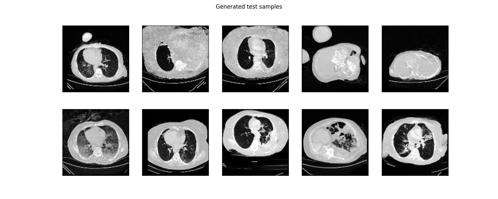
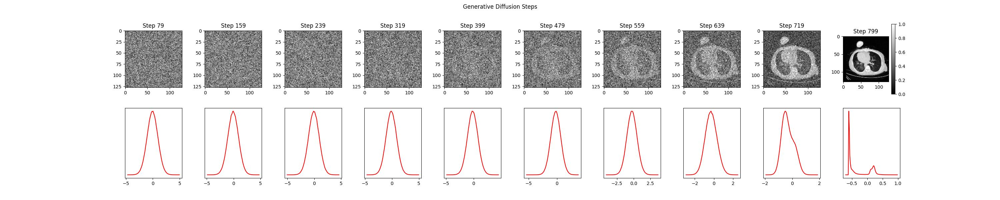
- Quality: good. Most slices look like real chest CTs (body outline, lungs with vessels, heart, spine, table). 2-3/10 have grainy soft tissue or odd anatomy. The final histogram has a clear air and soft-tissue peak

#### dg_cc_ct_x128.yaml (chuchichaestli UNet)
- Keywords: pixel-space 3D DDPM, chuchichaestli UNet, 128px
- GPU: H200
- Train: 51 EP, ~31h, ~20m/EP (stopped early: ValLoss_stagnated)

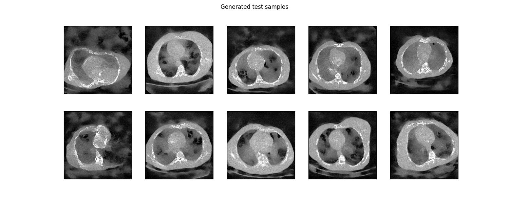
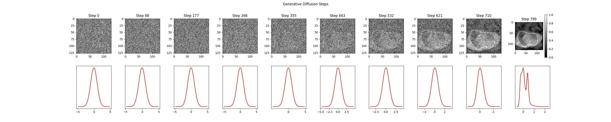
- Quality: bad. Body outline, ribs, spine and heart are in the right place, but the lungs are grey instead of black and the background is noisy. Worse than the MONAI version. The histogram has no separate air peak

#### dg_cc_ct_x256.yaml (chuchichaestli UNet, 256px)
- Keywords: same chuchichaestli setup, scaled to 256px, batch size 1, no dataset caching
- GPU: H200
- Train: 27 EP, ~126h, ~5.5h/EP

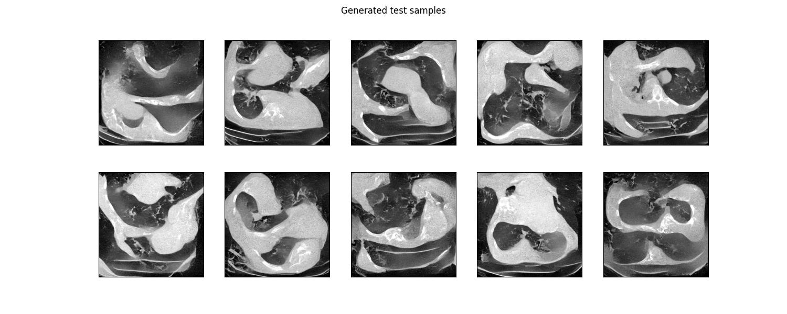
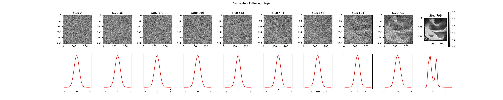
- Quality: bad. Local textures look like CT, but no sample has a coherent body. Too few epochs
- Next: pixel-space 3D diffusion at 256px is too slow here; latent diffusion (below) is the better option

---

### CBCT DIFF COND

Conditional DDPM, deblurring: the condition is the same volume with a Gaussian blur, applied slice by slice in the axial plane (`torchvision.transforms.GaussianBlur` blurs the last two dimensions only). The overview shows 10 test samples, rows: ground truth / condition / result / GT - result. The `test_gen_history` plot below it follows test sample 0 through the reverse diffusion process: an axial slice (top) and the histogram of the full volume (bottom) at 10 evenly spaced denoising steps.

#### dc_m_ct_x64_deblur.yaml (MONAI UNet, 64px)
- Keywords: conditional 3D DDPM, deblurring, MONAI UNet (small, 3 levels), 64px, blur sigma 2.5px
- GPU: V100
- Train: 82 EP, 9h19m, 6m41s/EP (stopped early: TrainLoss_stagnated)

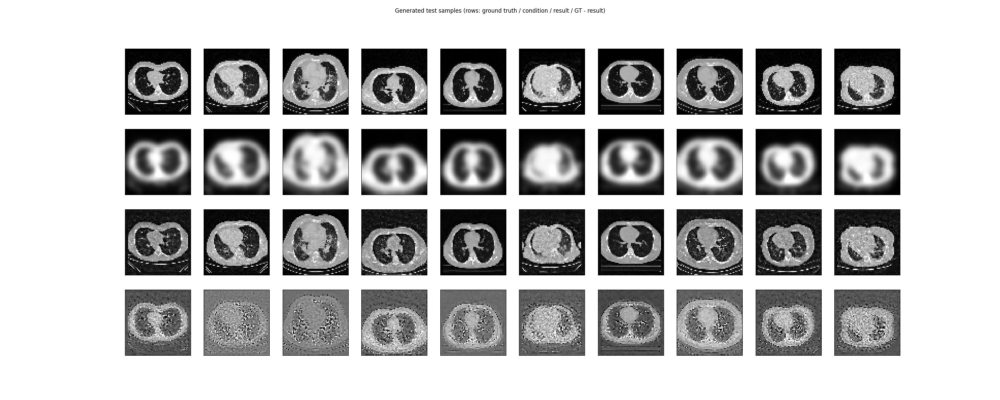
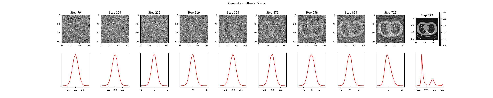
- Quality: ok. Overall anatomy and lung structure are recovered. The diff maps still show the body outline and heart (intensity offset), and the fine lung detail is made up rather than reconstructed

#### dc_m_ct_x128_deblur.yaml (MONAI UNet, 128px)
- Keywords: conditional 3D DDPM, deblurring, full-size MONAI UNet (4 levels), 128px, blur sigma 10px
- GPU: H200
- Train: 80 EP, ~68h, ~37m/EP

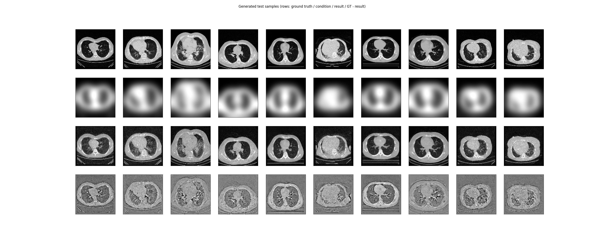
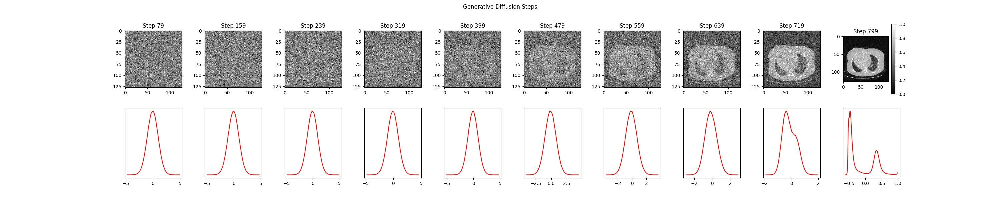
- Quality: ok. The blur leaves only a rough outline, but the results are plausible chest CTs with the right body shape, heart, spine and ribs. The fine detail does not match the GT though: the diff maps show the full anatomy and lung vessels. Some grain in the background
- Next: blur sigma 10px removes too much to reconstruct; a smaller sigma would make it a real deblurring test

#### dc_cc_ct_x64_deblur.yaml (chuchichaestli UNet, 64px)
- Keywords: conditional 3D DDPM, deblurring, chuchichaestli UNet (4 levels, attention at the deepest level), 64px, blur sigma 2px, best-val checkpoint
- GPU: H200
- Train: 124 EP, 5h10m, 2m25s/EP (stopped early: ValLoss_stagnated)
- Test: 10 samples, PSNR 22.2 (20.2 HU) vs. 21.7 (19.8 HU) for the condition itself

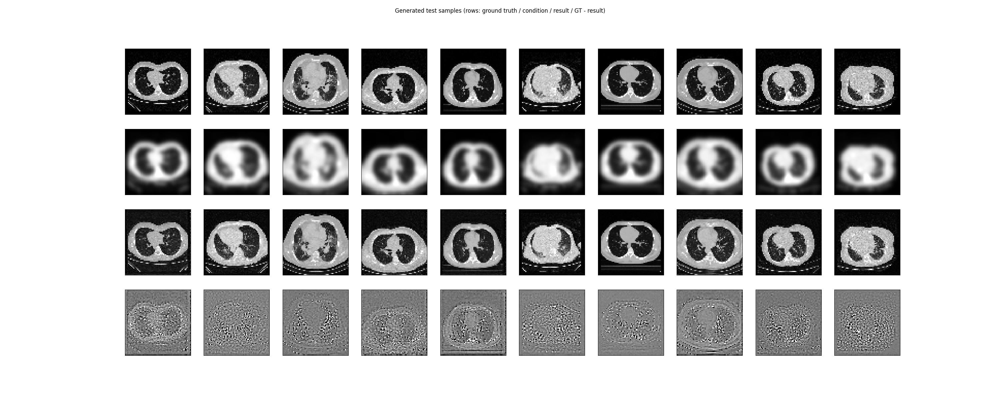
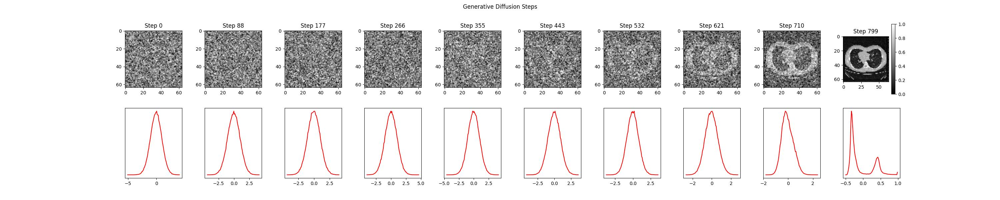
- Quality: ok. Results look sharp and the diff maps have no intensity offset. But PSNR is only 0.5 dB above the blurred input, so the detail looks plausible but is not accurate

---

### CBCT Latent Diffusion

Unconditional latent DDPM on CT-RATE volumes: a 3D chuchichaestli UNet is trained in the latent space of a frozen VAE, either the pretrained NVIDIA MAISI VAE (with the [0,1] normalization of `vae_cbct_maisi_x256_v2`) or the trained `vae_cbct_x*_v0` VAE from above. Each test generates 10 volumes from pure noise; the overview shows a transversal, sagittal and coronal slice of each. The `test_gen_history` plot below it follows test sample 0 through the reverse diffusion process, decoded to pixel space (top) and in latent space (bottom): a slice and the histogram of the full volume at 10 evenly spaced denoising steps.

#### lat_diff_cbct_maisi_x128.yaml (frozen MAISI VAE, 128px)
- Keywords: latent 3D DDPM, frozen pretrained MAISI VAE, latents 4x32x32x16, chuchichaestli UNet, 128px
- GPU: H200
- Train: 56 EP, 9h38m, 10m7s/EP (stopped early: TrainLoss_stagnated)

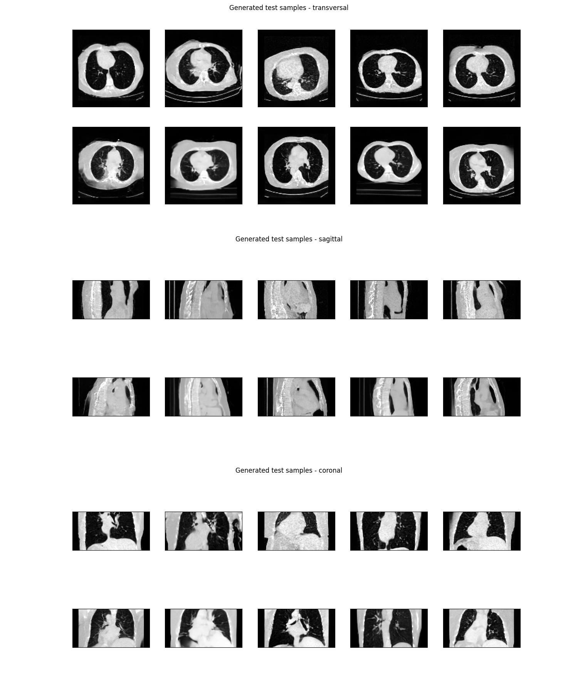
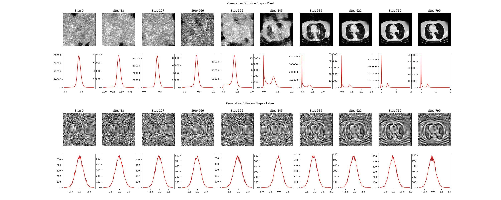
- Quality: good. All 10 samples look like chest CTs, with lung vessels, heart, spine and table, also in the sagittal and coronal views. Edges are a bit soft and some soft tissue is grainy

#### lat_diff_cbct_maisi_x256.yaml (frozen MAISI VAE, 256px)
- Keywords: same MAISI latent setup, scaled to 256px, latents 4x64x64x32, batch size 2
- GPU: H200
- Train: 37 EP, ~42h, ~50-73m/EP (stopped early: ValLoss_stagnated)

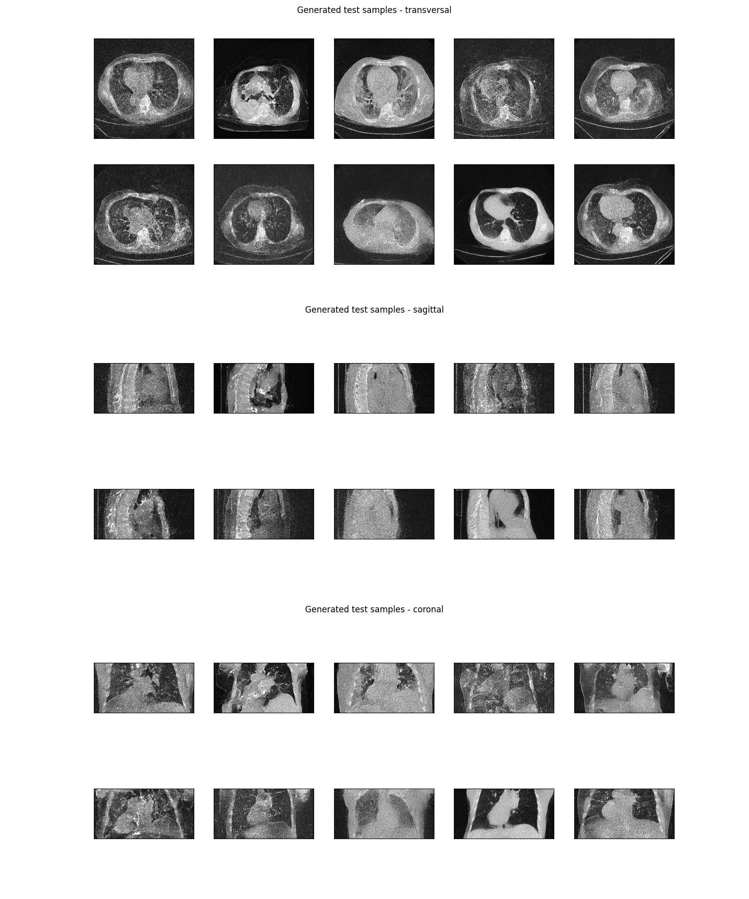
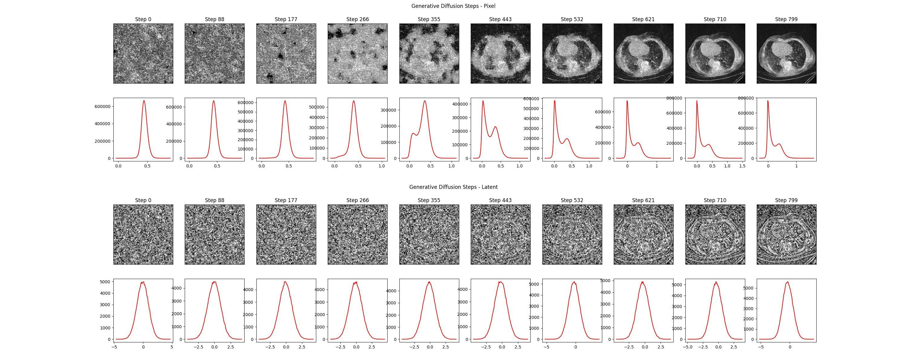
- Quality: bad. The anatomy is mostly in the right place, but almost all samples are very noisy, with a grey background and hazy lungs. Only 1/10 looks clean
- Next: train longer, e.g. with a larger `early_stop_val_loss` patience

#### lat_diff_cbct_monai_x128.yaml (frozen trained VAE, 128px)
- Keywords: latent 3D DDPM, frozen `vae_cbct_x128_v0` (trained above), latents 1x32x32x16, chuchichaestli UNet, 128px
- GPU: H200
- Train: 38 EP, 2h25m, 3m34s/EP (stopped early: TrainLoss_stagnated)

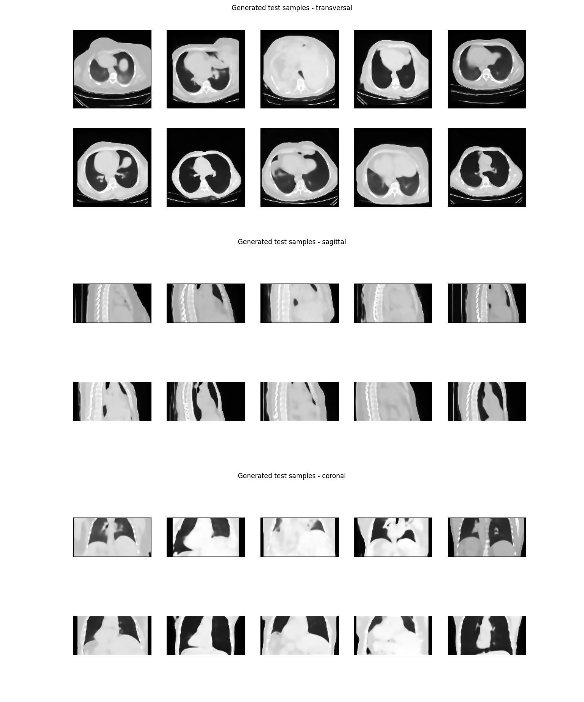
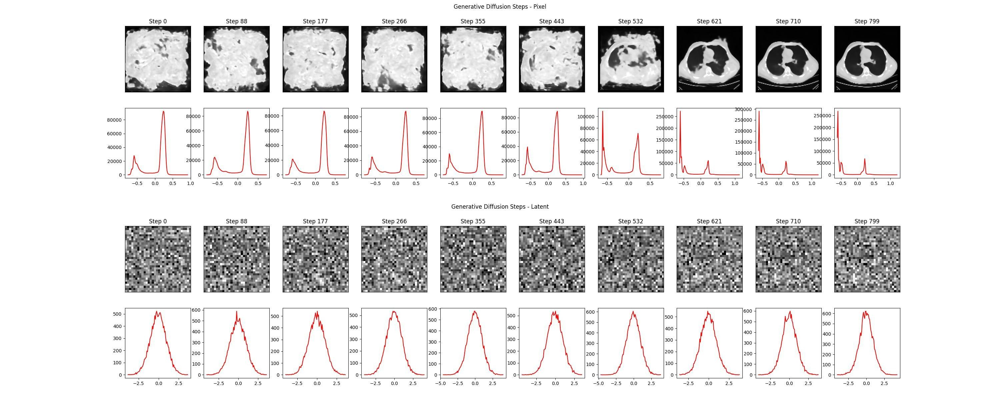
- Quality: ok. The anatomy is correct in most samples, but everything is very smooth, with no lung vessels. This is the same smooth look as the VAE's own reconstructions, so the VAE is the limit here

#### lat_diff_cbct_monai_x256.yaml (frozen trained VAE, 256px)
- Keywords: same setup with the frozen `vae_cbct_x256_v0`, latents 1x64x64x32, batch size 2, 256px
- GPU: H200
- Train: 36 EP, 17h23m, 28m9s/EP (stopped early: TrainLoss_stagnated)

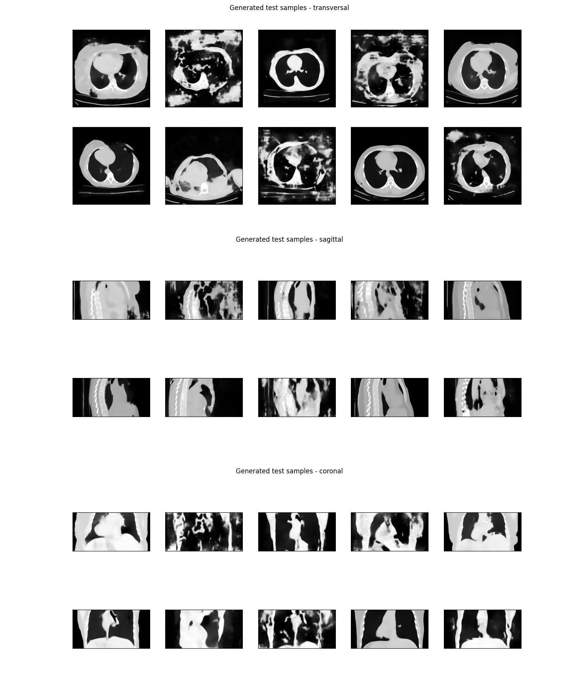
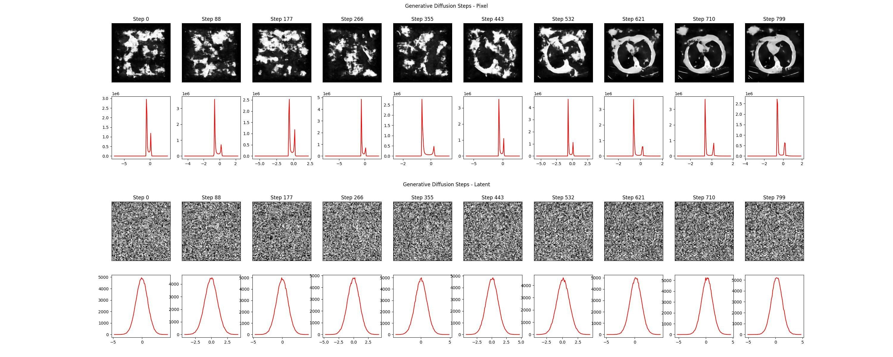
- Quality: bad. About half the samples are smooth chest CTs like the 128px run, the other half have bright blotches all over the background and a broken body outline

---

## References

### Methods
1. J. Ho, A. Jain, P. Abbeel. *Denoising Diffusion Probabilistic Models.* NeurIPS 2020. [arXiv:2006.11239](https://arxiv.org/abs/2006.11239), code: https://github.com/hojonathanho/diffusion
2. D. P. Kingma, M. Welling. *Auto-Encoding Variational Bayes.* ICLR 2014. [arXiv:1312.6114](https://arxiv.org/abs/1312.6114)
3. R. Rombach, A. Blattmann, D. Lorenz, P. Esser, B. Ommer. *High-Resolution Image Synthesis with Latent Diffusion Models.* CVPR 2022. [arXiv:2112.10752](https://arxiv.org/abs/2112.10752)
4. O. Ronneberger, P. Fischer, T. Brox. *U-Net: Convolutional Networks for Biomedical Image Segmentation.* MICCAI 2015. [arXiv:1505.04597](https://arxiv.org/abs/1505.04597)
5. P. Dhariwal, A. Nichol. *Diffusion Models Beat GANs on Image Synthesis.* NeurIPS 2021. [arXiv:2105.05233](https://arxiv.org/abs/2105.05233), code: https://github.com/openai/guided-diffusion
6. A. Dosovitskiy et al. *An Image is Worth 16x16 Words: Transformers for Image Recognition at Scale.* ICLR 2021. [arXiv:2010.11929](https://arxiv.org/abs/2010.11929)
7. W. Peebles, S. Xie. *Scalable Diffusion Models with Transformers (DiT).* ICCV 2023. [arXiv:2212.09748](https://arxiv.org/abs/2212.09748), code: https://github.com/facebookresearch/DiT
8. A. Nichol, P. Dhariwal. *Improved Denoising Diffusion Probabilistic Models* (cosine schedule). ICML 2021. [arXiv:2102.09672](https://arxiv.org/abs/2102.09672)
9. A. Jabri, D. Fleet, T. Chen. *Scalable Adaptive Computation for Iterative Generation* (sigmoid schedule). ICML 2023. [arXiv:2212.11972](https://arxiv.org/abs/2212.11972)
10. S. Lin, B. Liu, J. Li, X. Yang. *Common Diffusion Noise Schedules and Sample Steps Are Flawed* (zero terminal SNR). WACV 2024. [arXiv:2305.08891](https://arxiv.org/abs/2305.08891)
11. T. Salimans, J. Ho. *Progressive Distillation for Fast Sampling of Diffusion Models* (v-prediction). ICLR 2022. [arXiv:2202.00512](https://arxiv.org/abs/2202.00512)
12. Y. Lipman, R. T. Q. Chen, H. Ben-Hamu, M. Nickel, M. Le. *Flow Matching for Generative Modeling.* ICLR 2023. [arXiv:2210.02747](https://arxiv.org/abs/2210.02747)
13. Y. Lipman, M. Havasi, P. Holderrieth, N. Shaul, M. Le, B. Karrer, R. T. Q. Chen, D. Lopez-Paz, H. Ben-Hamu, I. Gat. *Flow Matching Guide and Code.* 2024. [arXiv:2412.06264](https://arxiv.org/abs/2412.06264), code: https://github.com/facebookresearch/flow_matching
14. J. Ho, T. Salimans. *Classifier-Free Diffusion Guidance.* NeurIPS 2021 Workshop on Deep Generative Models. [arXiv:2207.12598](https://arxiv.org/abs/2207.12598)

### Pretrained models
15. P. Guo, C. Zhao, D. Yang, Z. Xu, V. Nath, Y. Tang, B. Simon, M. Belue, S. Harmon, B. Turkbey, D. Xu. *MAISI: Medical AI for Synthetic Imaging.* WACV 2025. [arXiv:2409.11169](https://arxiv.org/abs/2409.11169), weights: [MONAI model zoo `maisi_ct_generative`](https://github.com/Project-MONAI/model-zoo/tree/dev/models/maisi_ct_generative)
16. Team Wan et al. *Wan: Open and Advanced Large-Scale Video Generative Models.* 2025. [arXiv:2503.20314](https://arxiv.org/abs/2503.20314), code: https://github.com/Wan-Video/Wan2.2, weights: [Wan-AI/Wan2.2-TI2V-5B-Diffusers](https://huggingface.co/Wan-AI/Wan2.2-TI2V-5B-Diffusers)

### Datasets
17. Z. Liu, P. Luo, X. Wang, X. Tang. *Deep Learning Face Attributes in the Wild* (CelebA). ICCV 2015. [arXiv:1411.7766](https://arxiv.org/abs/1411.7766), https://mmlab.ie.cuhk.edu.hk/projects/CelebA.html
18. T. Karras, T. Aila, S. Laine, J. Lehtinen. *Progressive Growing of GANs for Improved Quality, Stability, and Variation* (CelebA-HQ). ICLR 2018. [arXiv:1710.10196](https://arxiv.org/abs/1710.10196), https://github.com/tkarras/progressive_growing_of_gans
19. I. E. Hamamci, S. Er, C. Wang, F. Almas, A. G. Simsek, S. N. Esirgun, I. Dogan, O. F. Durugol, B. Hou, S. Shit, et al. *Generalist foundation models from a multimodal dataset for 3D computed tomography* (CT-RATE). Nature Biomedical Engineering, 2026. [arXiv:2403.17834](https://arxiv.org/abs/2403.17834), https://huggingface.co/datasets/ibrahimhamamci/CT-RATE
20. I. E. Hamamci, S. Er, A. Sekuboyina, E. Simsar, A. Tezcan, A. G. Simsek, S. N. Esirgun, F. Almas, I. Dogan, M. F. Dasdelen, et al. *GenerateCT: Text-Conditional Generation of 3D Chest CT Volumes.* ECCV 2024. [arXiv:2305.16037](https://arxiv.org/abs/2305.16037)
21. I. E. Hamamci, S. Er, B. Menze. *CT2Rep: Automated Radiology Report Generation for 3D Medical Imaging.* MICCAI 2024. [arXiv:2403.06801](https://arxiv.org/abs/2403.06801)
22. I. E. Hamamci, S. Er, S. Shit, H. Reynaud, D. Yang, P. Guo, M. Edgar, D. Xu, B. Kainz, B. Menze. *Better Tokens for Better 3D: Advancing Vision-Language Modeling in 3D Medical Imaging.* NeurIPS 2025.
23. I. E. Hamamci, S. Er, S. Shit, H. Reynaud, B. Kainz, B. Menze. *CRG Score: A Distribution-Aware Clinical Metric for Radiology Report Generation.* MIDL 2025 (short paper).

### Software
24. FDQ (fonduecaquelon), GPL-3.0: https://github.com/mstadelmann/fonduecaquelon
25. chuchichaestli, GPL-3.0: https://github.com/CAIIVS/chuchichaestli
26. M. J. Cardoso et al. *MONAI: An open-source framework for deep learning in healthcare.* 2022. [arXiv:2211.02701](https://arxiv.org/abs/2211.02701), Apache-2.0: https://github.com/Project-MONAI/MONAI
27. W. H. L. Pinaya et al. *Generative AI for Medical Imaging: extending the MONAI Framework.* 2023. [arXiv:2307.15208](https://arxiv.org/abs/2307.15208), tutorials (Apache-2.0): https://github.com/Project-MONAI/tutorials/tree/main/generation
28. P. von Platen et al. *Diffusers: State-of-the-art diffusion models.* Apache-2.0: https://github.com/huggingface/diffusers
29. A. Paszke et al. *PyTorch: An Imperative Style, High-Performance Deep Learning Library.* NeurIPS 2019. [arXiv:1912.01703](https://arxiv.org/abs/1912.01703)

## License

The code in this repository is licensed under the
[GNU General Public License v3.0 or later](LICENSE), except for the
third-party files listed below, which keep their original licenses:

| File | Origin | License |
|---|---|---|
| `meta_unet.py`, `meta_nn.py` | UNet of Meta's [flow_matching](https://github.com/facebookresearch/flow_matching) image example, derived from OpenAI [guided-diffusion](https://github.com/openai/guided-diffusion), with parts of [CLIP](https://github.com/openai/CLIP) and [VDM](https://github.com/google-research/vdm) | MIT ([LICENSES/MIT-OpenAI-guided-diffusion.txt](LICENSES/MIT-OpenAI-guided-diffusion.txt), [LICENSES/MIT-OpenAI-CLIP.txt](LICENSES/MIT-OpenAI-CLIP.txt)), VDM part Apache-2.0 ([LICENSES/Apache-2.0.txt](LICENSES/Apache-2.0.txt)) |

Dependencies are installed separately and keep their own licenses. Note in
particular that the `flow_matching` library used by
`meta_flow_match_train.py` is licensed CC BY-NC 4.0 (non-commercial), and
that the datasets and the MAISI weights are restricted to non-commercial
research use (see [Data and licenses](#data-and-licenses)).

The figures in `assets/` that show CT-RATE data are licensed under
[CC BY-NC-SA 4.0](https://creativecommons.org/licenses/by-nc-sa/4.0/).

## Acknowledgements

CT-RATE was created by Hamamci et al. [[19]](#references); its data was provided
by Istanbul Medipol University Mega Hospital. CelebA was created by the
Multimedia Laboratory of The Chinese University of Hong Kong [[17]](#references),
CelebA-HQ by Karras et al. (NVIDIA) [[18]](#references).
