# Diffusion experiments using FDQ

Reference implementations of VAEs, pixel-space and latent diffusion, DiT/ViT
backbones, and flow matching, built on top of
[FDQ](https://github.com/mstadelmann/fonduecaquelon). Two domains: face
generation on CelebA-HQ and CT volume generation/reconstruction on CBCT/CT-RATE.

**Goal**: this repo is not an attempt to produce the best possible images. It's
a playground for exploring and comparing different diffusion-style generative
methods side by side - a starting point for anyone curious about the topic.
Expect visible artifacts, undertrained runs, and outright failures alongside
the good results.

- https://github.com/mstadelmann/fdq_diffusion
- https://github.com/mstadelmann/fonduecaquelon
- https://github.com/CAIIVS/chuchichaestli

## Running an experiment

Locally:
```bash
pip install fdq[full]
git clone https://github.com/mstadelmann/fdq_diffusion.git
cd fdq_diffusion
fdq --config-path configs/celeb_vae --config-name vae_celeb_x128_00_base
```

On a Slurm cluster:

The `slurm_cluster` settings in these configs (partition, account, module
names, storage paths) are tuned for the
[ZHAW SoE Cluster](https://hpc.engineering.zhaw.ch/) (reachable only from
within the ZHAW network). Adjusting the partition/account names and the
system-specific paths will get this running on any Slurm cluster, or of
course locally wherever fdq can be installed.

```bash
# lightweight submit extra, no PyTorch required on the login node
pip install fdq[submit]
git clone https://github.com/mstadelmann/fdq_diffusion.git
cd fdq_diffusion
fdq_submit configs/celeb_vae/vae_celeb_x128_00_base.yaml
```

If package installation is restricted on the login node, use the standalone script:
```bash
wget https://raw.githubusercontent.com/mstadelmann/fonduecaquelon/refs/heads/main/src/fdq/submit.py
python submit.py configs/celeb_vae/vae_celeb_x128_00_base.yaml
```

`submit_celeb.sh` and `submit_ct.sh` list every configured experiment - run
them line by line, not as a script. Executing either file as-is submits every
experiment in it back to back, which is a lot of Slurm jobs and GPU-hours at
once.

## Experiments

| Directory | Contents |
|---|---|
| `configs/celeb_vae` | VAE pretraining, latent space for the models below |
| `configs/celeb_diff_gen_monai` | pixel-space DDPM, MONAI UNet |
| `configs/celeb_diff_gen_cc` | pixel-space DDPM, chuchichaestli UNet |
| `configs/celeb_diff_gen_vit` | pixel-space DDPM, DiT/ViT backbone |
| `configs/celeb_latent_diff` | latent DDPM, UNet backbone |
| `configs/celeb_latent_diff_vit` | latent DDPM, DiT/ViT backbone |
| `configs/celeb_fm_gen` | flow matching, UNet backbone |
| `configs/cbct_vae` | VAE pretraining on CT volumes |
| `configs/cbct_diff_gen`, `cbct_diff_gen_monai` | pixel-space DDPM on CT volumes |
| `configs/cbct_diff_cond_monai` | conditional DDPM, artifact/blur correction |
| `configs/cbct_latent_diff` | latent DDPM on CT volumes |

## Data

**Celeb**: [bitmind/celeb-a-hq](https://huggingface.co/datasets/bitmind/celeb-a-hq)
on Hugging Face - 30,000 images at native 1024x1024, CC-BY-4.0, no login or
token required. Downloaded once and cached locally; see `hf_preparator_celeb.py`.
Train/val/test are fixed, non-overlapping slices of that single split (by row
index, not random), so they're identical across runs.

**CBCT/CT**: currently trained on a locally preprocessed copy of
[CT-RATE](https://huggingface.co/datasets/ibrahimhamamci/CT-RATE) staged on
the cluster (see `nifity_preparator.py`, `data.ctrate.args.root_path`). Not
yet loaded directly from Hugging Face - migrating this to the same
download-once approach used for Celeb is planned.


## Results

### CELEB VAE

#### vae_celeb_x128_00_dist2.yaml
- Keywords: VAE, KL-regularized autoencoder, 128px, latents for the models below
- GPU: 2x A100
- Train: 365 EP, 5h4m, 54s/EP


- Quality: sharp, faithful reconstructions, no visible artifacts

#### vae_celeb_x256_00.yaml
- Keywords: VAE, 256px, higher-resolution latents
- GPU: H100
- Train: 223 EP, 17h51m, 7m32s/EP

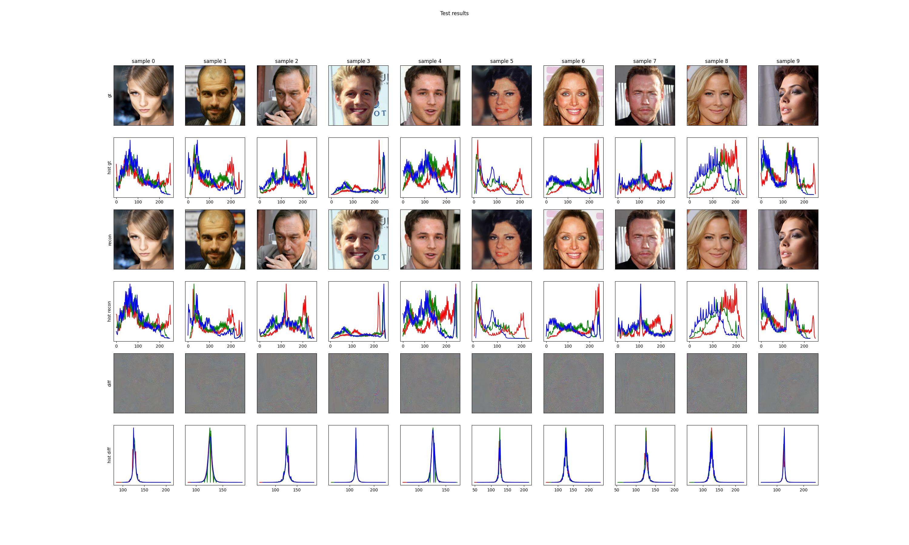
- Quality: sharp, faithful reconstructions, on par with the 128px VAE

#### vae_celeb_x512_00.yaml
- Keywords: VAE, 512px, highest-resolution latents
- GPU: H200
- Train: 259 EP, 42h19m combined, 9m28s/EP (stopped early: ValLoss_stagnated)

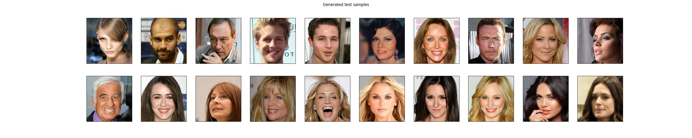
- Quality: sharp, faithful reconstructions, no degradation despite early stop

---

### CELEB DIFF GEN

#### MONAI UNet

##### dg_m_cele_x128_00_base_dist2.yaml
- Keywords: pixel-space DDPM, MONAI UNet, baseline architecture, 128px
- GPU: 2x A100
- Train: 65 EP, 4h16m, 3m48s/EP

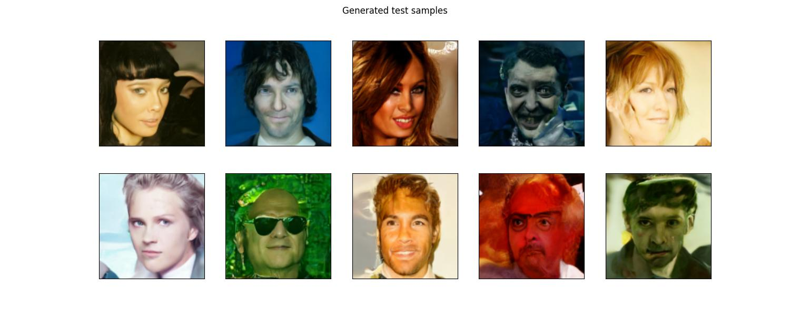
- Quality: bad - about 4/10 faces have unnatural green/red skin-tone artifacts, not real-looking

##### dg_m_cele_x128_01.yaml (res-block off)
- Keywords: architecture ablation, UNet residual blocks disabled
- GPU: 2x A100
- Train: 183 EP, 10h36m, 3m22s/EP

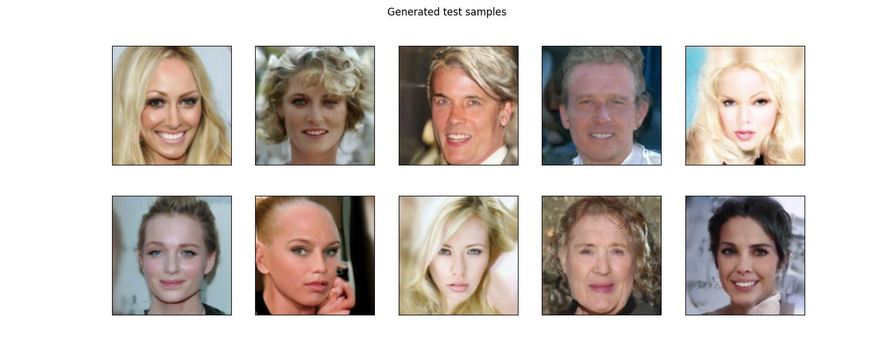
- Quality: good - all 10 faces read as real, no color-cast or anatomical distortion

##### dg_m_cele_x128_02.yaml (3 att levels)
- Keywords: architecture ablation, attention at 3 resolution levels
- GPU: 2x A100
- Train: 153 EP, 19h58m, 7m42s/EP

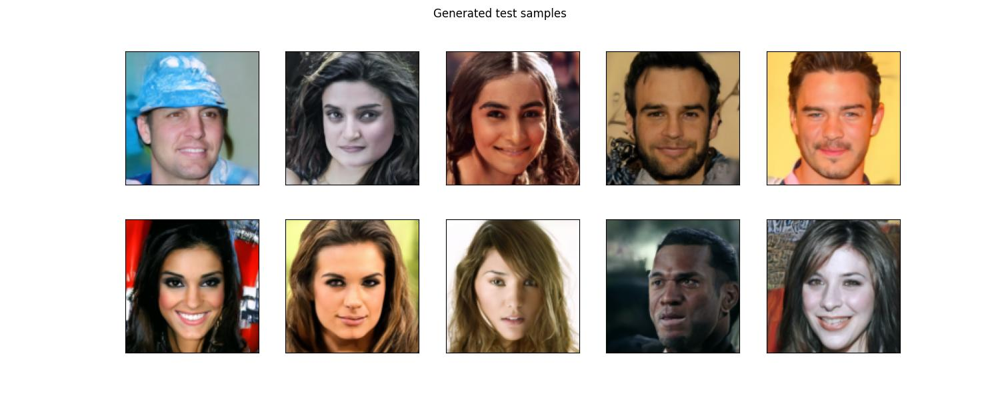
- Quality: good - all 10 faces read as real, only faint background bleed on 1-2

##### dg_m_cele_x128_03.yaml (4 layers only)
- Keywords: capacity ablation, UNet depth reduced to 4 levels
- GPU: 2x A100
- Train: 85 EP, 9h51m, 6m52s/EP

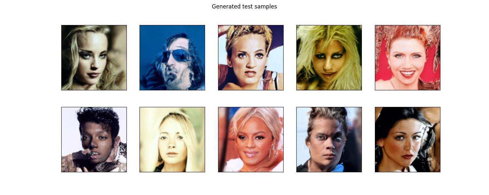
- Quality: good - coherent, real-looking faces despite heavy punk/goth styling; no anatomical distortion

##### dg_m_cele_x128_08_zero_snr.yaml (zero-SNR fix, v-pred)
- Keywords: zero terminal-SNR noise schedule, v-prediction parameterization
- GPU: 2x A100
- Train: 96 EP, 6h16m, 3m46s/EP

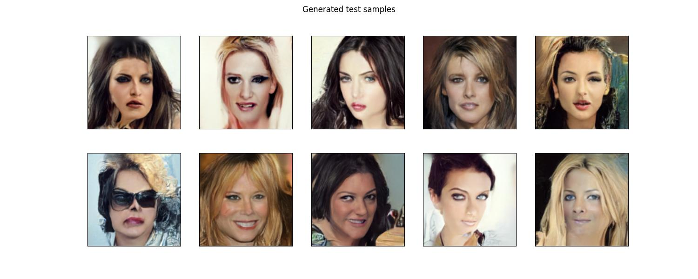
- Quality: good - real, coherent faces despite heavy makeup styling

##### dg_m_cele_x256_00.yaml (256px, 2 GPUs)
- Keywords: same baseline architecture, scaled to 256px
- GPU: 2x H200
- Train: 149 EP, 40h35m combined, 13m35s/EP (stopped early: TrainLoss_stagnated)

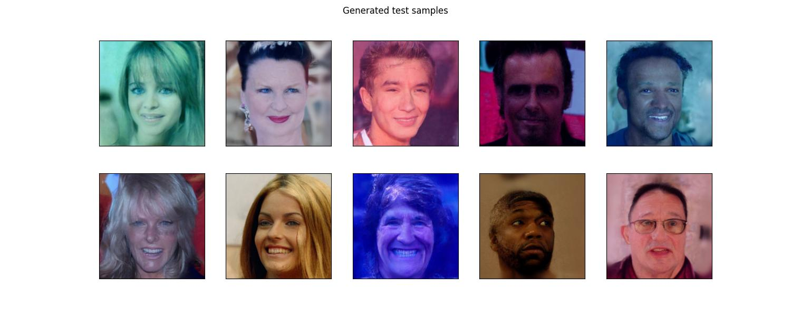
- Quality: bad - every one of the 10 faces has an unnatural color-cast (teal/blue/red/maroon skin), none look like real skin tones

##### dg_m_cele_x256_01_zero_snr.yaml (256px, zero-SNR fix)
- Keywords: zero-SNR/v-pred fix applied at 256px
- GPU: 2x H200
- Train: 109 EP, 11h2m, 6m0s/EP

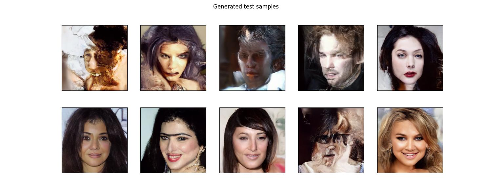
- Quality: bad - only about 4/10 faces look genuinely real; the rest are severely textured, melted, or scribbled beyond recognition

#### Chuchichaestli UNet

##### dg_c_celeb_x128_00_base.yaml (baseline)
- Keywords: pixel-space DDPM, chuchichaestli UNet, baseline architecture, 128px
- GPU: 2x A100
- Train: 165 EP, 2h41m, 1m0s/EP

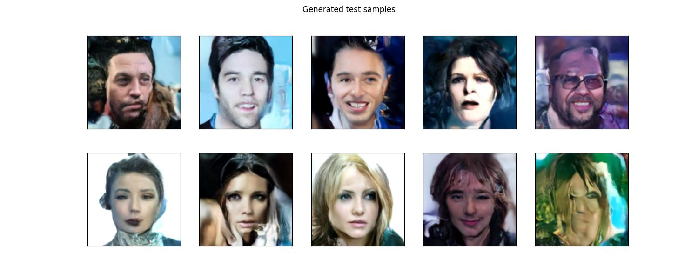
- Quality: mixed - 1/10 completely unrealistic (green cast merging into hair/background), several others have background texture bleeding into the face

##### dg_c_celeb_x128_01.yaml (LR param, 4 parallel runs)
- Keywords: learning-rate sweep, 4 parallel runs at different LR values
- GPU: 2x A100

| Train | Image | Quality |
|---|---|---|
| 178 EP, 2h55m, 1m0s/EP | 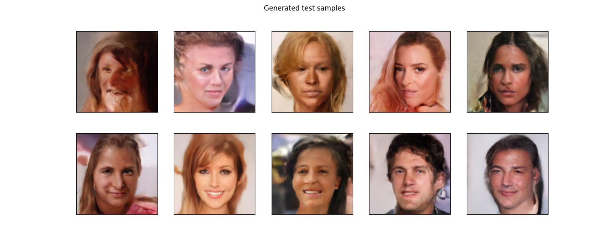 | 1/10 badly melted/deformed (not a real face), rest look real |
| 116 EP, 1h52m, 54s/EP | 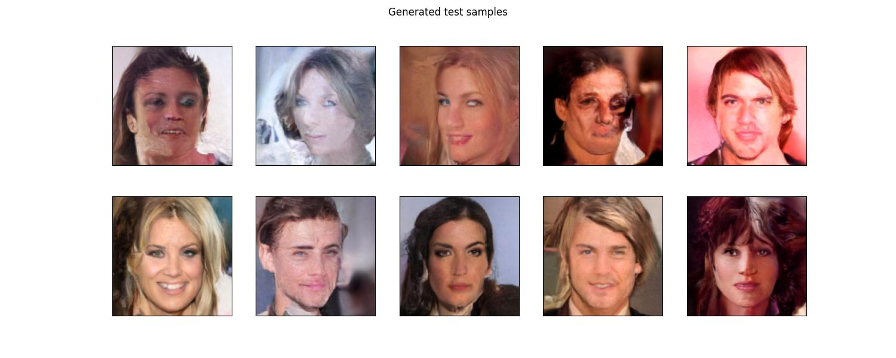 | 1/10 an indistinct blurry non-face, rest look real |
| 166 EP, 2h40m, 54s/EP | 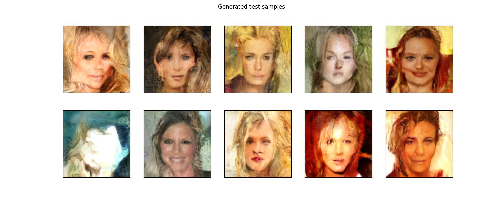 | bad - every face rendered as a thick oil-painting texture, none look like real photos |
| 146 EP, 2h22m, 59s/EP | 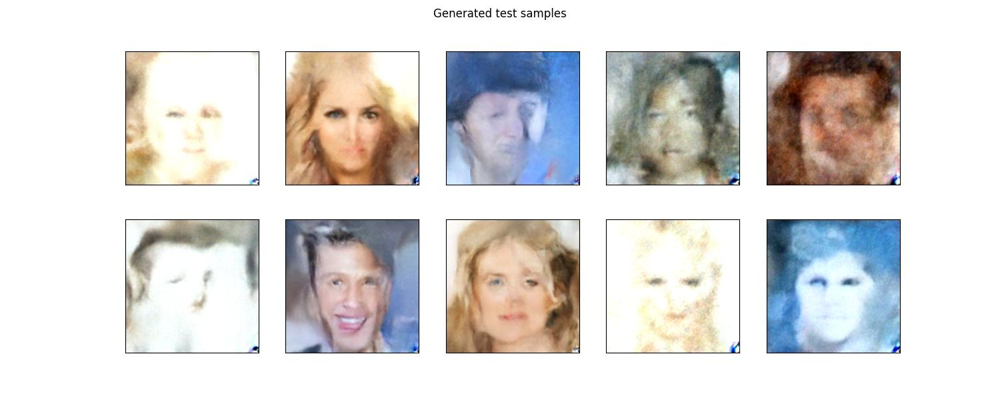 | bad - most faces (6/10) are foggy, ghostly, or indistinct, not recognizable as real |

##### dg_c_celeb_x128_02.yaml (lin/cos/sig param, 3 parallel runs)
- Keywords: noise-schedule sweep, linear vs cosine vs sigmoid beta schedule, 3 parallel runs
- GPU: 2x A100

| Train | Image | Quality |
|---|---|---|
| 200 EP, 3h11m, 56s/EP | 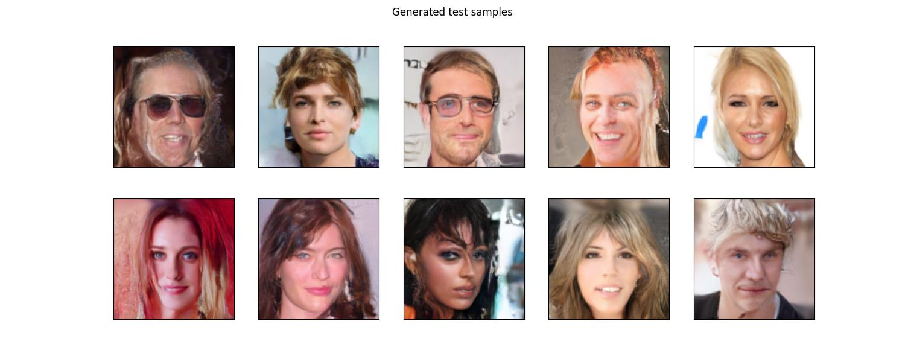 | good - all 10 faces look real and coherent |
| 172 EP, 2h44m, 53s/EP | 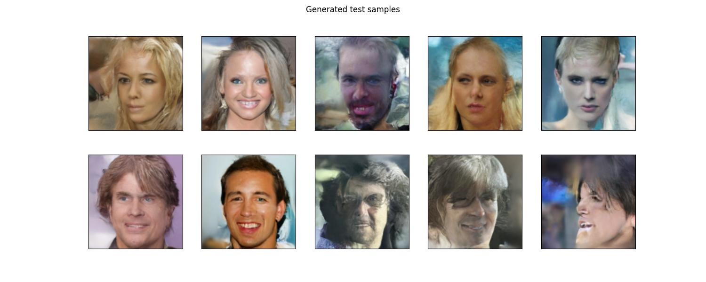 | 2/10 unnatural (bright orange scalp patch, deep magenta face), rest look real |
| 216 EP, 3h31m, 54s/EP | 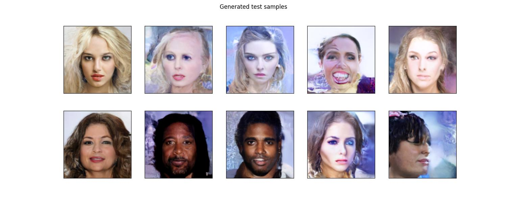 | 2/10 clearly unrealistic (indistinct dark face, magenta cast), rest look real |

##### dg_c_celeb_x256_00_base.yaml (256px)
- Keywords: same baseline architecture, scaled to 256px
- GPU: 2x H200
- Train: 130 EP, 2h29m, 1m5s/EP

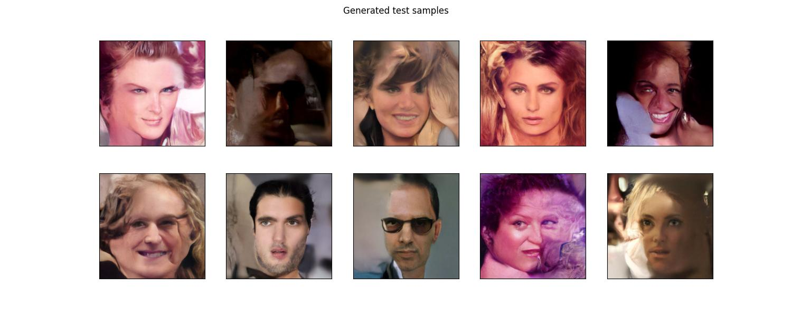
- Quality: mixed - 2/10 clearly unrealistic (indistinct dark face, magenta cast), rest look real

#### VIT (DiT)

##### dg_vit_celeb_x128_00_base_dist2.yaml (2 GPUs)
- Keywords: pixel-space DDPM, DiT/ViT backbone instead of UNet, 128px
- GPU: 2x A100
- Train: 350 EP, 56h33m combined, 9m32s/EP

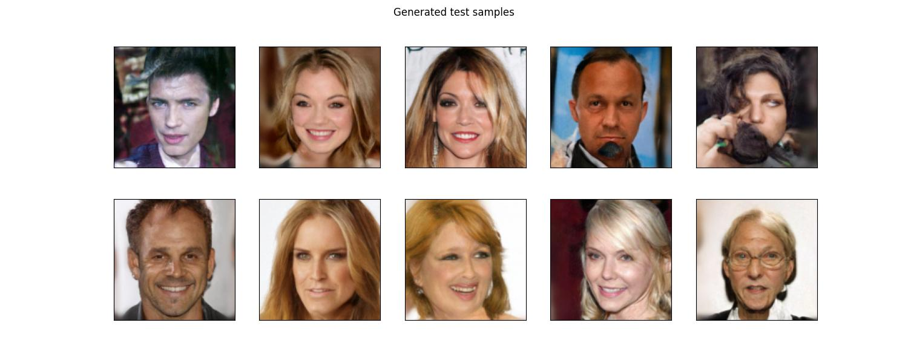
- Quality: mixed - 2/10 have a dark disfiguring blob over the mouth/chin, rest look real

##### dg_vit_celeb_x256_00_base.yaml (256px, 2 GPUs)
- Keywords: same ViT/DiT backbone, scaled to 256px
- GPU: 2x H200
- Train: 302 EP, 35h16m combined, 10m50s/EP (stopped early: TrainLoss_stagnated)

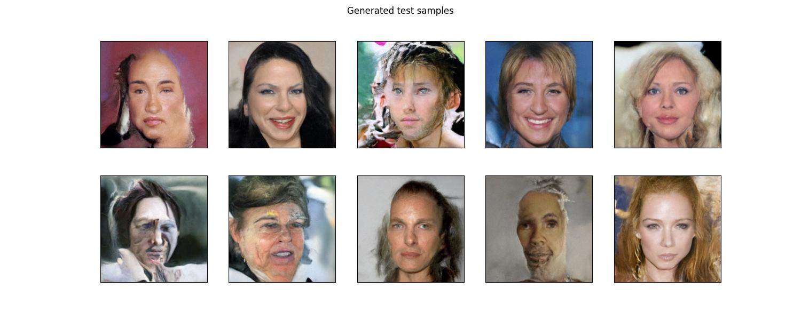
- Quality: bad - half the faces (5/10) are heavily smeared or textured, not recognizable as real skin

---

### CELEB DIFF COND

#### dc_m_celeb_x128_deblur.yaml (MONAI UNet)
- Keywords: conditional DDPM, deblurring, blurred image as condition, MONAI UNet
- GPU: A100
- Train: 126 EP, 16h9m, 7m41s/EP (stopped early: ValLoss_stagnated)

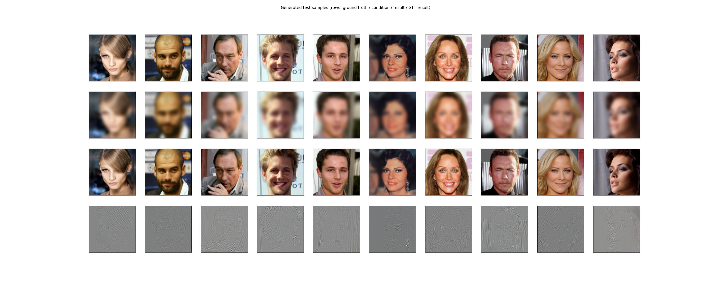
- Quality: excellent, deblurred result nearly indistinguishable from ground truth

#### dc_cc_celeb_x128_deblur.yaml (chuchichaestli UNet)
- Keywords: same conditional deblurring task, chuchichaestli UNet backbone
- GPU: 2x A100
- Train: 154 EP, 2h49m, 1m6s/EP (stopped early: ValLoss_stagnated)

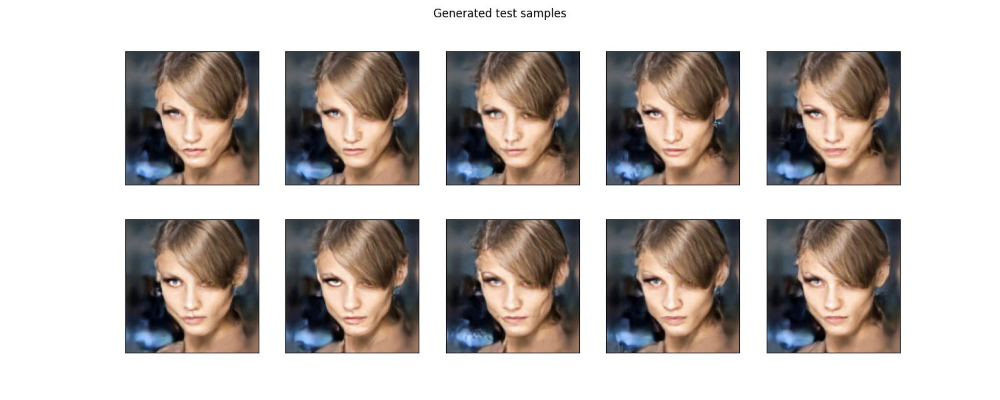
- Quality: excellent, on par with the MONAI version

#### dc_cc_celeb_x128_hard.yaml (harder condition: blur + cutout + salt-pepper + Gaussian noise)
- Keywords: conditional DDPM, chuchichaestli UNet, condition stacks blur with random cutout patches, salt-and-pepper noise, and Gaussian noise (resampled every epoch), inpainting/denoising rather than plain deblurring
- GPU: 2x A100
- Train: 102 EP, 2h12m, 1m9s/EP (stopped early: ValLoss_stagnated)

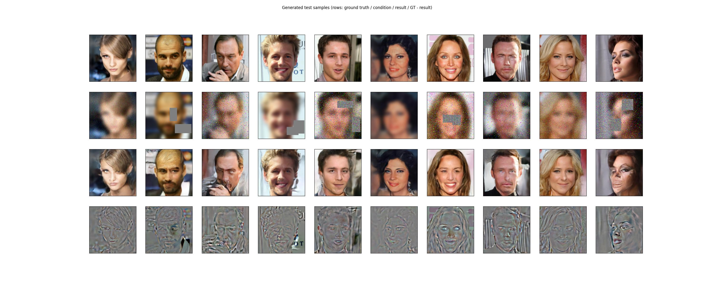
- Quality: good - 9/10 results closely match GT despite the heavy corruption, 1/10 has a residual dark artifact around the eyes

#### dc_cc_celeb_x128_halfface.yaml (condition is half the face blacked out)
- Keywords: conditional DDPM, chuchichaestli UNet, outpainting, condition is the GT with a random half (left/right, resampled every epoch via RandomEdgeMask) blacked out, model reconstructs the missing half
- GPU: 2x A100
- Train: 159 EP, 2h44m, 56s/EP (stopped early: ValLoss_stagnated)

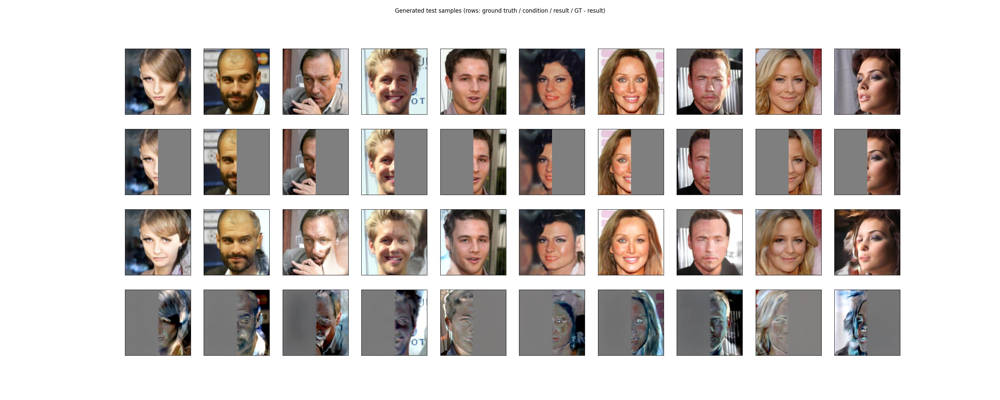
- Quality: good - 9/10 outpainted halves are plausible and coherent with the visible half, 1/10 (a hard side-profile sample that also struggled in dc_cc_celeb_x128_hard) is smeared/artifacted

---

### CELEB Latent Diffusion

#### lat_diff_celeb_x128_00_base.yaml (UNet backbone)
- Keywords: diffusion over frozen VAE latents, UNet backbone, 128px
- GPU: H200
- Train: 224 EP, 15h2m, 4m2s/EP (stopped early: ValLoss_stagnated)

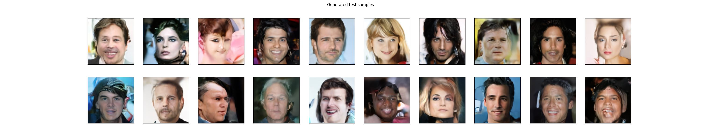
- Quality: good - 19/20 faces look real, 1 with rough discolored skin

#### lat_diff_celeb_x256_00.yaml (256px)
- Keywords: same latent UNet approach, scaled to 256px
- GPU: H200
- Train: 174 EP, 13h5m, 4m31s/EP (stopped early: TrainLoss_stagnated)

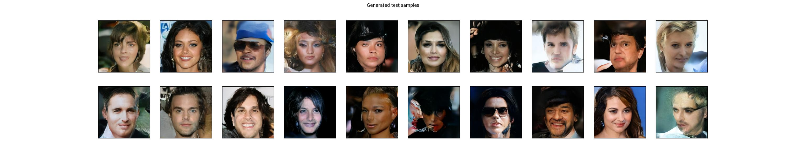
- Quality: good - 19/20 faces look real, 1 clearly non-human (rough beast-like texture)

#### VIT (DiT) backbone, same pretrained VAEs

##### lat_diff_vit_celeb_x128_00_base.yaml
- Keywords: latent diffusion, DiT/ViT backbone instead of UNet, 128px
- GPU: H200
- Train: 400 EP, 13h27m, 2m2s/EP

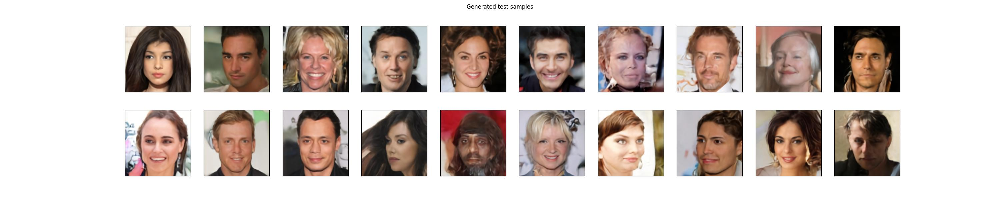
- Quality: good - all 20 faces look real, no standout failures

##### lat_diff_vit_celeb_x256_00.yaml (256px)
- Keywords: same latent ViT/DiT approach, scaled to 256px
- GPU: H200
- Train: 400 EP, 52h29m combined, 7m47s/EP

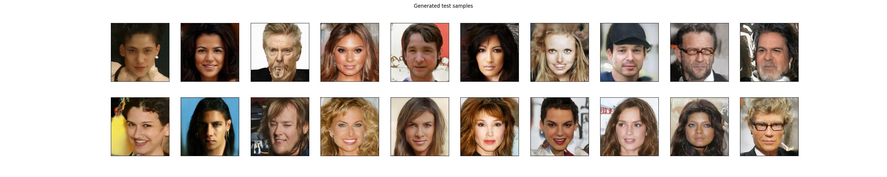
- Quality: good - 19/20 faces look real, 1 clearly non-human (same recurring beast-like texture as the UNet 256px run)

### CELEB Flow Matching Generative

#### fm_meta_cele_x128_v0.yaml (baseline)
- Keywords: flow matching, MetaUNet, straight-line velocity-field regression, no fixed noise schedule, 128px
- GPU: 2x H200
- Train: 650 EP, 84h20m combined, 7m47s/EP

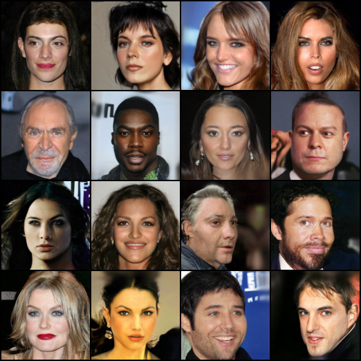
- Quality: excellent, the sharpest and most photorealistic results in this repo

#### fm_meta_cele_x128_v1.yaml (smaller batch)
- Keywords: same flow matching setup, smaller training batch size
- GPU: 2x H200
- Train: 650 EP, 80h26m combined, ~7m25s/EP (1 restart from scratch after a DDP/NCCL crash)

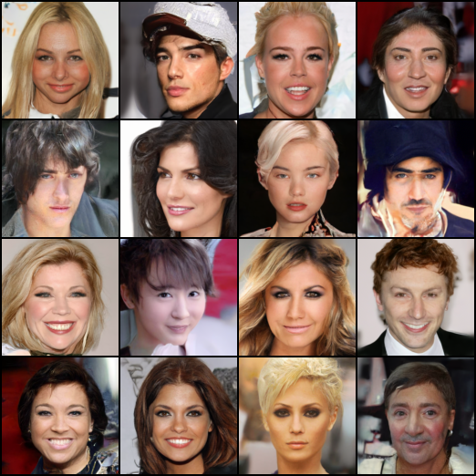
- Quality: excellent, on par with the baseline

#### fm_meta_cele_x128_v2.yaml (EMA, attn tweaks)
- Keywords: adds EMA weight averaging and attention-head tweaks to the baseline
- GPU: 2x H200
- Train: 424/650 EP so far, 46h10m combined, 6m32s/EP - stuck, every resume attempt crashes on a DDP/NCCL ALLREDUCE timeout; retry queued
- Quality: not yet available (no completed test run)

#### fm_meta_cele_x256_v0.yaml (256px)
- Keywords: same baseline flow matching setup, scaled to 256px
- GPU: 2x H200
- Train: in progress, target 650 EP
- Quality: not yet available (still training)
